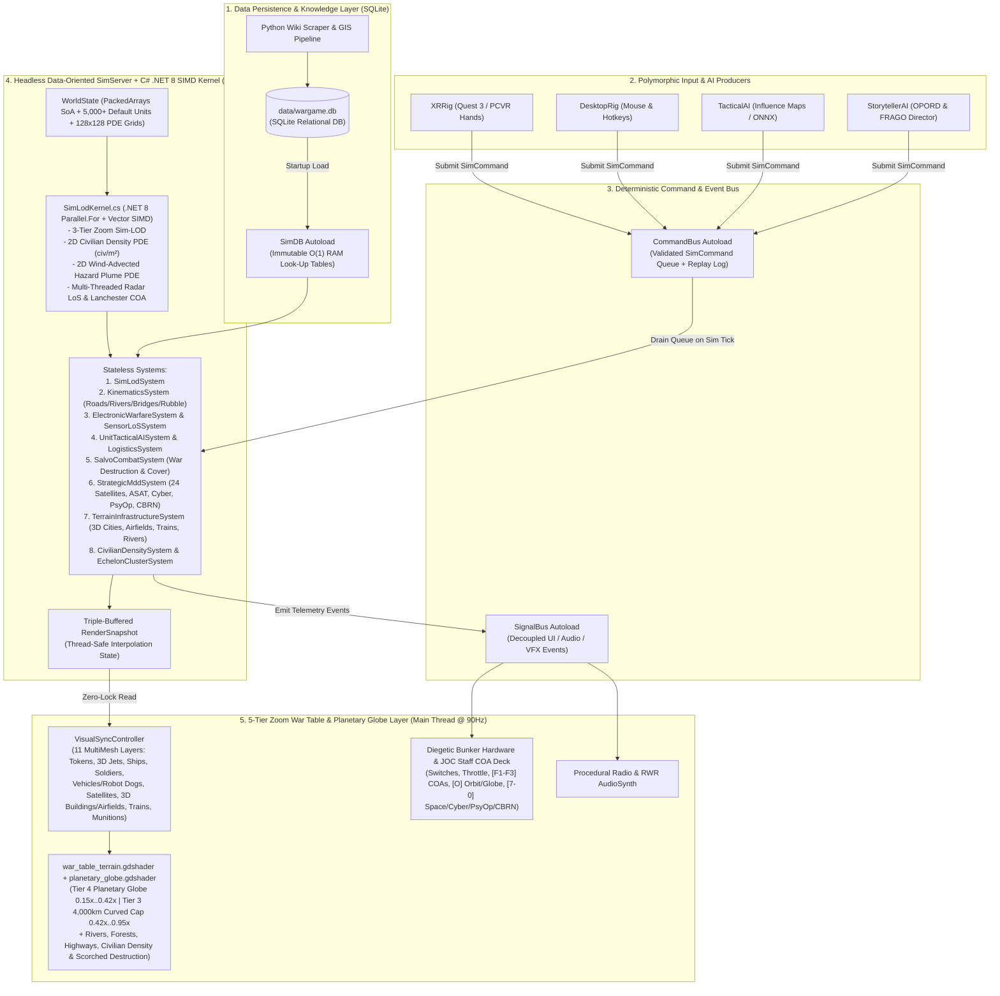
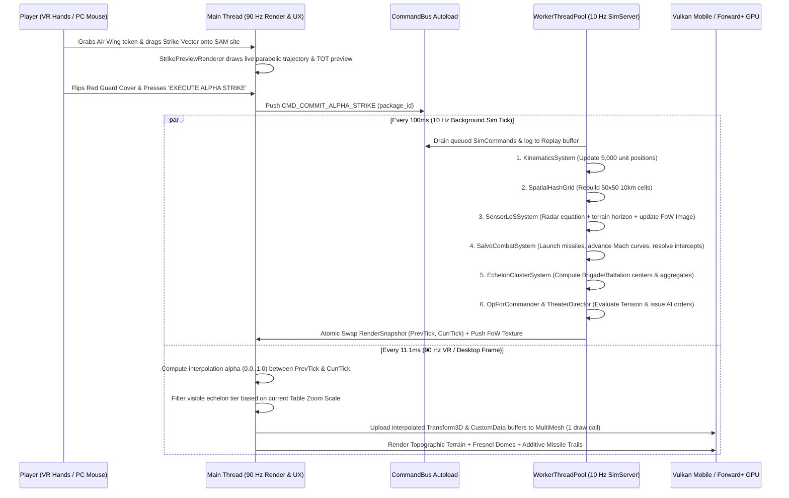
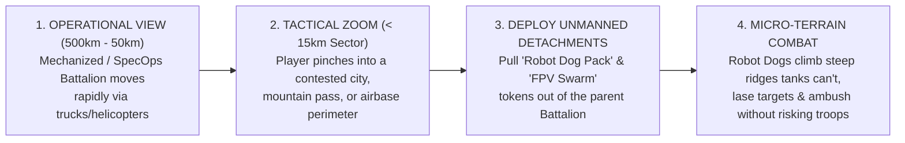
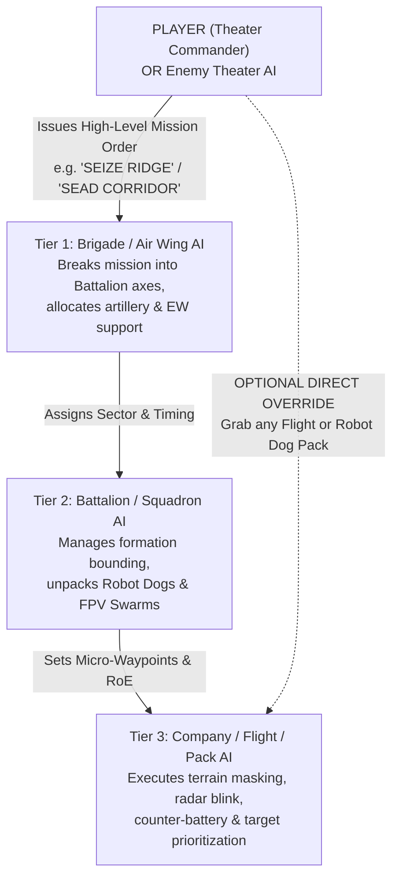
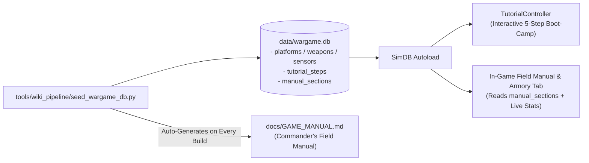

# VR & PC Holographic Wargame Simulator — Godot 4.7 & SQLite Architectural Runway

> [!IMPORTANT]
> **Purpose of This Document:** This is the authoritative engineering blueprint ("Architectural Runway") for building, scaling, and shipping the game in **Godot 4.7** with **SQLite (`godot-sqlite`)** across **PC (Flatscreen + PCVR)** and **Meta Quest 3 Standalone**.
> **Commercial Target:** \$25 price point, 10,000+ units sold across Steam (PC + PCVR) and Meta Quest Store.

---

## 1. Platform & Hardware Architecture Analysis: PC vs. Meta Quest 3

A critical early question is: **Where should the simulation and rendering run—PC, Quest 3 Standalone, or both?**

### 1.1 Hardware Reality Check

| Capability | Meta Quest 3 Standalone (Snapdragon XR2 Gen 2) | Gaming PC (Flatscreen & PCVR Link/Virtual Desktop) |
| :--- | :--- | :--- |
| **CPU** | 6 usable ARM64 cores (~2.4 GHz) | 8–16 x86_64 cores (4.5–5.5 GHz) |
| **GPU / Renderer** | Adreno 740 — **Godot 4.7 Vulkan Mobile Renderer** | Dedicated GPU — **Godot 4.7 Forward+ or Vulkan Mobile** |
| **Memory** | 8 GB Unified RAM (~5.2 GB available to app) | 16–64 GB System RAM + 8–24 GB VRAM |
| **Target Frame Budget** | **72 Hz (13.8 ms)** or **90 Hz (11.1 ms)** stereo with Application SpaceWarp | **90–144 Hz** (VR or Flatscreen Monitor) |
| **Compute Shaders / Post-FX** | Supports Vulkan Compute Shaders; fullscreen HDR bloom is costly on tile-based GPU | Practically unlimited compute shaders, volumetric fog, and ACES HDR bloom |

### 1.2 Architectural Verdict: "Unified Codebase with Adaptive Tiering"

Because our visuals are **stylized holographic vectors, MultiMesh tokens, and a single heightmap shader** (rather than 4K PBR foliage and skinned character meshes), **the entire game and simulation CAN run 100% natively on Quest 3 Standalone** while scaling up visually on PC—**if and only if** we follow strict Godot 4.7 mobile-friendly patterns from Day 1:

1. **Use Godot 4.7's `Vulkan Mobile` Renderer as the Baseline (with `Forward+` Overrides for PC):**
   - Instead of expensive post-process fullscreen glow on Quest 3, achieve the "glowing neon hologram" look using **Unshaded Additive Vertex-Colored Meshes + Pre-Baked Glow Falloff Textures + Fresnel Rim Shaders**. On Quest 3's tile-based GPU, additive blending and Fresnel shaders cost almost zero fragment time and look identical to HDR bloom!
   - On PC (`Forward+` feature tag), automatically enable full ACES HDR Glow, SSR on the obsidian table glass, and volumetric bunker fog.
2. **Offload Simulation Ticks to Godot 4.7's `WorkerThreadPool`:**
   - The main thread **only** handles XR head/hand tracking, UI input, and uploading `MultiMesh` transform buffers (`< 2 ms` per frame).
   - The heavy simulation (`SimCore`: movement, spatial hash, radar LoS, combat, and AI influence maps) runs asynchronously on background worker threads via `WorkerThreadPool.add_group_task()` at a fixed **10 Hz simulation tick** (`100 ms` budget!).
   - On Quest 3's multi-core Snapdragon XR2 Gen 2, 100 ms on background threads easily processes **3,000–5,000 active tokens** without ever stalling the 90 Hz VR render thread.
3. **Optional "PC Host $\rightarrow$ Quest 3 Thin Client" Bonus:**
   - Because all actions flow through `CommandBus`, a player with both a PC and a Quest 3 can also run massive 15,000-unit + local LLM scenarios hosted on their PC while walking around the table untethered on Quest 3 over Wi-Fi.

---

## 2. Core Godot 4.7 Architectural Design Patterns

To keep the codebase modular, bug-free, and scalable from v0.1 to post-launch ML expansions, the project enforces **7 canonical Godot 4.7 patterns**:



### Pattern 1: SQLite Database + Immutable `SimDB` RAM Cache (Zero Runtime Disk I/O)
- **Why SQLite (`godot-sqlite` GDExtension):** Storing 500+ Wikipedia platforms, 300+ munitions, sensor profiles, historical battalion TO&E templates, and campaign telemetry in thousands of loose JSON files becomes slow and unmanageable for relational queries (e.g., *"Find all SAM batteries from 1995–2025 with radar range > 80km and cost < \$50M"*).
- **How It Works:**
  1. All static military data, theater sites, and campaign history live in `res://data/wargame.db` (plus `user://mods.db` for player mods).
  2. At game boot, the `SimDB` Autoload queries SQLite **once** and packs every platform, weapon, and sensor into contiguous, integer-indexed GDScript arrays (`PlatformDef`, `WeaponDef`).
  3. During simulation ticks, `WorldState` stores `platform_id: int` (e.g., `42`) instead of strings (`"f_16cj_block50"`), giving **$O(1)$ array lookup speed** with zero SQLite queries during gameplay.
  4. Post-battle telemetry, dynamic campaign persistence, and Storyteller logs are written back to SQLite asynchronously between missions.

### Pattern 2: Custom Server Pattern + Structure-of-Arrays (`SimServer` & `WorldState`)
- **Rule:** Never instantiate a `Node3D`, `CharacterBody3D`, or `Area3D` for individual units or missiles.
- **How It Works:**
  - Following Godot's own internal Server architecture (`RenderingServer`, `PhysicsServer3D`), our `SimServer` manages `WorldState`—a pure `RefCounted` object holding pre-allocated `PackedVector3Array`, `PackedFloat32Array`, and `PackedInt32Array` buffers for up to `MAX_UNITS = 8192` and `MAX_MUNITIONS = 16384`.
  - Stateless system classes (`KinematicsSystem`, `SensorLoSSystem`, `SalvoCombatSystem`, `EchelonClusterSystem`) iterate over active indices using `WorkerThreadPool.add_group_task()`.

### Pattern 3: Triple-Buffered Snapshot Interpolation (Decoupling 10 Hz Sim from 90 Hz VR)
- **The Problem:** If the simulation runs at 10 Hz (every 100 ms) on a background thread, but the VR headset renders at 90 Hz (every 11.1 ms), tokens will stutter if rendered directly from sim ticks, or crash if threads race on memory.
- **The Solution (`RenderSnapshotBuffer`):**
  - `SimServer` maintains 3 pre-allocated `RenderSnapshot` structs (`PrevTick`, `CurrTick`, `WriteScratch`).
  - When a 10 Hz sim tick finishes on the worker thread, it atomically swaps pointers.
  - Every 90 Hz render frame on the main thread, `VisualSyncController` computes `alpha = clamp((time_now - tick_time) / TICK_DELTA, 0.0, 1.0)` and smoothly `lerp()`s unit and missile positions directly into the `MultiMesh` `Transform3D` buffer!
  - **Result:** Butter-smooth 90 FPS motion in VR even if the simulation tick takes 40 ms of heavy AI calculation on a background core.

### Pattern 4: Deterministic Command Pattern (`CommandBus`)
- **Rule:** Neither the VR hands, the PC mouse, nor the AI is ever allowed to mutate `WorldState` directly.
- Every action is encapsulated as a lightweight `SimCommand` dictionary/struct pushed to `CommandBus`:
  - `CMD_MOVE_WAYPOINTS` (`unit_ids`, `waypoints_3d`, `speed_mode`, `tot_timestamp`)
  - `CMD_SET_DOCTRINE` (`unit_ids`, `radar_active`, `weapon_roe`, `evasion_posture`)
  - `CMD_QUEUE_STRIKE` (`package_id`, `attacker_ids`, `target_id`, `weapon_id`, `salvo_count`)
  - `CMD_COMMIT_ALPHA_STRIKE` (`package_id`)
- At the start of each 10 Hz simulation tick, `SimServer` drains the `CommandBus` queue, records each command into the SQLite `replay_commands` log with the current `tick_id`, and applies it deterministically.

### Pattern 5: Hierarchical Echelon Graph & Semantic Zoom (`EchelonClusterSystem`)
- Every unit in `WorldState` has an `echelon_level` (`0 = Company/Flight`, `1 = Battalion/Squadron`, `2 = Brigade/Wing`) and a `parent_unit_id`.
- Parent echelons (`Brigade` and `Battalion`) exist as virtual command nodes in the same `WorldState` arrays:
  - Their position is the dynamically updated **center-of-mass** of their alive subordinate units.
  - Their health/ammo bar is the **aggregate sum** of their subordinates.
- When the player's War Table zoom scale is `< 0.25` (Macro 500 km view), `VisualSyncController` sets `visible = true` on `Brigade` tokens and hides `Company` tokens. As the player zooms into a valley, `Brigade` tokens fade into translucent bounding rings and `Battalion` $\rightarrow$ `Company` tokens emerge seamlessly.
- Issuing an order to a `Brigade` token automatically propagates formation-offset orders to all child `Battalion` and `Company` units.

### Pattern 6: Diegetic Polymorphic Interaction (`ICommandRig` & `TactileInteractable`)
- To support **Quest 3 / PCVR Hands** and **Flatscreen Mouse/Keyboard** with zero duplicate gameplay code, both rigs implement the same interaction interface:
  - **World-Space Ray / Pinch Cursor:** Emits `hover_entered(pos_3d)`, `select_pressed(pos_3d)`, `drag_updated(pos_3d, height_offset)`, `select_released(pos_3d)`.
  - **Physical Bunker Controls (`TactileSwitch3D`, `TactileThrottle3D`, `GuardedButton3D`):** Inherit from `TactileInteractable`. In VR, a player's hand collider or laser physically rotates the lever/cover with haptic pulses (`XRController3D.trigger_haptic_pulse()`). On PC, clicking and dragging with the mouse animates the exact same 3D lever with mechanical audio clunks.

### Pattern 7: Shader Globals & GPU Texture Driven Fog-of-War
- Instead of per-unit fog-of-war meshes, `SensorLoSSystem` writes a compact **`512×512` `Image.FORMAT_RG8` Visibility & Threat Texture** each sensor tick (`R = Friendly Radar Coverage`, `G = Known Enemy SAM Threat`).
- This small texture is pushed to a **Godot 4.7 Global Shader Uniform (`global uniform sampler2D fow_threat_map`)**.
- Both the `war_table_terrain.gdshader` and unit holographic shaders sample `fow_threat_map` in real time to illuminate radar-swept valleys in cyan, tint lethal SAM zones in pulsing amber/crimson, and dim unobserved territory.

---

## 3. Complete SQLite Database Architecture (`data/wargame.db`)

All Wikipedia-scraped equipment, historical formations, theaters, and campaign saves use this normalized SQLite schema:

```sql
-- 1. PLATFORMS (Aircraft, SAM Batteries, Armor Platoons, Warships, Radars)
CREATE TABLE platforms (
    platform_id INTEGER PRIMARY KEY AUTOINCREMENT,
    slug TEXT UNIQUE NOT NULL,              -- e.g., 'f_16cj_block50', 's_400_battery'
    display_name TEXT NOT NULL,
    wiki_url TEXT,
    country_origin TEXT NOT NULL,           -- 'USA', 'RUS', 'CHN', 'NATO', etc.
    service_year INTEGER NOT NULL,
    domain TEXT NOT NULL,                   -- 'AIR', 'LAND', 'SEA', 'STATIC'
    unit_class TEXT NOT NULL,               -- 'FIGHTER', 'STRIKE', 'AWACS', 'SAM', 'ARMOR', 'ARTILLERY', 'SHIP'
    nato_symbol_code TEXT NOT NULL,         -- Used to select holographic icon/silhouette
    max_speed_knots REAL NOT NULL,
    cruise_speed_knots REAL NOT NULL,
    combat_radius_km REAL NOT NULL,
    max_altitude_m REAL NOT NULL,
    rcs_m2 REAL NOT NULL,                   -- Radar Cross Section (m^2): 0.001 (F-35) to 100.0 (B-52)
    ir_signature REAL NOT NULL,             -- 0.1 to 2.0
    armor_rating REAL DEFAULT 0.0,
    max_hp REAL NOT NULL,
    elements_per_token INTEGER DEFAULT 4,   -- e.g., 4 aircraft per Flight, 8 Robot Dogs per Pack
    unit_cost_musd REAL NOT NULL,           -- Cost in Millions USD (for economic war scoring)
    autonomy_level TEXT DEFAULT 'MANNED',   -- 'MANNED', 'RF_DATALINK', 'FIBER_OPTIC', 'AUTONOMOUS_AI'
    can_climb_steep_slopes INTEGER DEFAULT 0, -- 1 for Quadruped Robot Dogs & Mountain Infantry
    carrier_sub_platform_slug TEXT DEFAULT '', -- e.g., 'vision_60_dog_pack' or 'fpv_swarm_team'
    carrier_sub_count INTEGER DEFAULT 0,    -- Number of deployable unmanned detachments carried
    directed_energy_kw REAL DEFAULT 0.0,    -- >0 for Iron Beam / DE M-SHORAD / Leonidas HPM
    de_aoe_cone_deg REAL DEFAULT 0.0        -- 0.0 = single-target laser beam, 30.0 = HPM microwave cone
);

-- 2. SENSORS (Radars, RWR/ESM, Electro-Optical, Sonar)
CREATE TABLE sensors (
    sensor_id INTEGER PRIMARY KEY AUTOINCREMENT,
    slug TEXT UNIQUE NOT NULL,              -- e.g., 'an_apg_68', '91n6e_big_bird'
    display_name TEXT NOT NULL,
    sensor_type TEXT NOT NULL,              -- 'ACTIVE_RADAR', 'PASSIVE_ESM', 'IR_EO'
    max_range_km REAL NOT NULL,             -- Range against a standard 5.0 m^2 RCS target
    min_altitude_m REAL DEFAULT 0.0,
    look_down_shoot_down INTEGER DEFAULT 1, -- 1 = can filter ground clutter, 0 = blinded by terrain backdrop
    can_guide_weapons INTEGER DEFAULT 1
);

-- 3. WEAPONS & MUNITIONS (Missiles, Bombs, Artillery Shells, Decoys)
CREATE TABLE weapons (
    weapon_id INTEGER PRIMARY KEY AUTOINCREMENT,
    slug TEXT UNIQUE NOT NULL,              -- e.g., 'aim_120d', 'agm_88e_harm', '48n6e3', 'adm_160_mald'
    display_name TEXT NOT NULL,
    wiki_url TEXT,
    target_domainMask INTEGER NOT NULL,     -- Bitmask: 1=AIR, 2=LAND, 4=SEA, 8=RADAR_EMITTER, 16=MISSILE
    guidance_type TEXT NOT NULL,            -- 'ACTIVE_RADAR', 'SEMI_ACTIVE', 'ANTI_RADIATION', 'GPS_INS', 'IR', 'DECOY'
    max_range_km REAL NOT NULL,
    no_escape_range_km REAL NOT NULL,
    min_range_km REAL NOT NULL,
    speed_mach REAL NOT NULL,
    flight_profile TEXT NOT NULL,           -- 'DIRECT', 'LOFTED_BALLISTIC', 'SEA_SKIM_TERCOM'
    base_pk REAL NOT NULL,                  -- 0.0 to 1.0 probability of kill
    warhead_damage REAL NOT NULL,
    is_interceptable INTEGER DEFAULT 1,     -- Can SAMs/CIWS shoot this munition down?
    round_cost_musd REAL NOT NULL           -- Cost per shot in Millions USD (e.g., 4.0 for PAC-3, 0.02 for Shahed)
);

-- 4. PLATFORM SENSORS & LOADOUTS (Join Tables)
CREATE TABLE platform_sensors (
    platform_id INTEGER REFERENCES platforms(platform_id),
    sensor_id INTEGER REFERENCES sensors(sensor_id),
    PRIMARY KEY (platform_id, sensor_id)
);

CREATE TABLE platform_loadouts (
    loadout_id INTEGER PRIMARY KEY AUTOINCREMENT,
    platform_id INTEGER REFERENCES platforms(platform_id),
    role_code TEXT NOT NULL,                -- 'CAP', 'SEAD', 'DEAD_STRIKE', 'STANDARD'
    display_name TEXT NOT NULL,
    weapon_1_id INTEGER REFERENCES weapons(weapon_id),
    weapon_1_qty INTEGER DEFAULT 0,
    weapon_2_id INTEGER REFERENCES weapons(weapon_id),
    weapon_2_qty INTEGER DEFAULT 0
);

-- 5. ECHELON FORMATION TEMPLATES (Brigade -> Battalion -> Company TO&E)
CREATE TABLE formation_templates (
    template_id INTEGER PRIMARY KEY AUTOINCREMENT,
    slug TEXT UNIQUE NOT NULL,              -- e.g., 'us_abct_brigade', 'ru_s400_regiment'
    display_name TEXT NOT NULL,
    faction TEXT NOT NULL,
    echelon_level INTEGER NOT NULL,         -- 2 = Brigade/Wing, 1 = Battalion/Squadron
    child_entries_json TEXT NOT NULL        -- JSON array of child templates or platform_ids + offsets
);

-- 6. THEATERS & STRATEGIC SITES (500km x 500km Map Metadata)
CREATE TABLE theaters (
    theater_id INTEGER PRIMARY KEY AUTOINCREMENT,
    slug TEXT UNIQUE NOT NULL,              -- e.g., 'taiwan_strait', 'hormuz', 'fulda_gap'
    display_name TEXT NOT NULL,
    size_km REAL DEFAULT 500.0,
    min_elevation_m REAL DEFAULT -500.0,
    max_elevation_m REAL DEFAULT 4000.0,
    heightmap_res_path TEXT NOT NULL
);

CREATE TABLE theater_sites (
    site_id INTEGER PRIMARY KEY AUTOINCREMENT,
    theater_id INTEGER REFERENCES theaters(theater_id),
    site_name TEXT NOT NULL,
    site_type TEXT NOT NULL,                -- 'AIRBASE', 'NAVAL_PORT', 'COMMAND_BUNKER', 'CITY', 'CHOKEPOINT'
    x_km REAL NOT NULL,
    z_km REAL NOT NULL,
    strategic_value INTEGER DEFAULT 100
);

-- 7. AI STORYTELLER & CAMPAIGN PERSISTENCE
CREATE TABLE campaign_events (
    event_id INTEGER PRIMARY KEY AUTOINCREMENT,
    campaign_id INTEGER NOT NULL,
    mission_turn INTEGER NOT NULL,
    event_type TEXT NOT NULL,               -- 'OPORD_BRIEFING', 'FRAGO_TWIST', 'AAR_SUMMARY'
    headline TEXT NOT NULL,
    narrative_body TEXT NOT NULL,
    blue_losses_musd REAL DEFAULT 0.0,
    red_losses_musd REAL DEFAULT 0.0
);
```

---

## 4. Godot 4.7 Project Structure & Scene Hierarchy

```text
vrarmygame/
├── project.godot                           # Godot 4.7 config (Vulkan Mobile default + Forward+ PC tag)
├── ARCHITECTURE.md                         # This architectural runway document
├── addons/
│   └── godot-sqlite/                       # SQLite GDExtension (Windows x86_64 + Android ARM64 Quest 3)
├── data/
│   ├── wargame.db                          # Master SQLite database (auto-built by tools/build_db.py)
│   ├── seed_sql/                           # Version-controlled SQL seed files & Wikipedia JSON dumps
│   └── theaters/                           # 16-bit PNG heightmaps & precomputed slope textures
├── src/
│   ├── autoloads/
│   │   ├── sim_db.gd                       # Loads wargame.db into O(1) RAM LUTs at startup
│   │   ├── command_bus.gd                  # Deterministic command queue & replay serializer
│   │   └── signal_bus.gd                   # Decoupled events for UI, Audio, and Bunker hardware
│   ├── sim_core/                           # Pure Data-Oriented Simulation (Zero Node3D dependencies)
│   │   ├── sim_server.gd                   # Manages WorkerThreadPool 10Hz loop & Snapshot swapping
│   │   ├── world_state.gd                  # Structure-of-Arrays (PackedVector3Array, etc.) + Echelon tree
│   │   ├── spatial_hash_grid.gd            # 50x50 grid (10km cells) for O(1) range queries
│   │   ├── render_snapshot.gd              # Triple-buffered lock-free interpolation state
│   │   └── systems/
│   │       ├── kinematics_system.gd        # 3D waypoint splines, cruise/burn speed, fuel
│   │       ├── sensor_los_system.gd        # Radar horizon math, RCS scaling, FoW texture generation
│   │       ├── ew_system.gd                # Radar ON/OFF states, jamming cones, decoy baiting
│   │       ├── salvo_combat_system.gd      # Salvo launch, Mach ballistic curves, intercept & Pk rolls
│   │       └── echelon_cluster_system.gd   # Brigade -> Battalion -> Company center-of-mass & zoom state
│   ├── ai/
│   │   ├── tactical/
│   │   │   ├── influence_map.gd            # Threat & Radar Blindspot grids over heightmap
│   │   │   └── opfor_commander.gd          # Utility AI doctrines (IADS ambush, SEAD wave, QRF)
│   │   └── storyteller/
│   │       ├── theater_director.gd         # Campaign tension curve, FRAGO injection, OPORD generator
│   │       └── narrative_templates.gd      # Zero-API-cost dynamic military briefing composer
│   └── presentation/
│       ├── bunker/
│       │   ├── command_bunker.tscn         # Main Scene: Brutalist bunker + War Table + Rigs
│       │   └── hardware/                   # TactileSwitch3D, TactileThrottle3D, GuardedCommitButton3D
│       ├── war_table/
│       │   ├── war_table.tscn              # 1.8m x 1.8m Holographic Sand Table root
│       │   ├── visual_sync_controller.gd   # 90Hz MultiMesh updater (Units, Stems, Missiles, Domes)
│       │   ├── strike_preview_renderer.gd  # Live dashed parabolic salvo & TOT preview lines
│       │   └── shaders/
│       │       ├── war_table_terrain.gdshader  # Obsidian ocean + 200m iso-contours + FoW global texture
│       │       ├── hologram_token.gdshader     # NATO plaque + health/ammo bars + echelon glow
│       │       └── fresnel_dome.gdshader       # Additive Fresnel threat shell + terrain intersection ring
│       ├── rigs/
│       │   ├── xr_command_rig.gd           # OpenXR Quest 3 / PCVR hands, two-hand table zoom, haptics
│       │   └── desktop_command_rig.gd      # Orbital camera, box/cylinder brush, hotkeys, strike planner
│       └── audio/
│           └── bunker_radio_synth.gd       # Concatenative AWACS voice callouts + Radio DSP + RWR tones
└── tools/
    ├── wiki_pipeline/
    │   └── scrape_and_seed_sqlite.py       # Fetches Wikipedia infoboxes & builds data/wargame.db
    └── terrain_pipeline/
        └── generate_theater.py             # Generates 500km heightmaps & theater_sites in wargame.db
```

---

## 5. Frame & Tick Execution Lifecycle (90 Hz Render vs. 10 Hz Sim)



---

## 6. Radar & Combat Simulation Formulas (Authentic yet Fast)

To make Wikipedia numbers produce emergent, realistic modern warfare in microseconds:

1. **Radar Horizon & Terrain Masking Check:**
   $$\text{MaxHorizonKm} = 4.12 \times \left(\sqrt{h_{\text{radar\_m}}} + \sqrt{h_{\text{target\_m}}}\right)$$
   - Before checking terrain, if `distance_km > MaxHorizonKm`, the target is below the Earth's curvature! This immediately rewards keeping strike aircraft at low altitude (`100m`) and flying AWACS at high altitude (`10,000m`).
   - Next, `SensorLoSSystem` marches 8 sample points along the line segment in the heightmap texture; if any mountain ridge exceeds the line altitude at that point, the unit is **Terrain Masked**.
2. **Radar Cross Section (RCS) Detection Scaling (Fourth-Root Radar Equation):**
   $$\text{EffectiveDetectionRangeKm} = \text{BaseRadarRangeKm} \times \left(\frac{\text{TargetRCS}_{m^2}}{5.0}\right)^{0.25}$$
   - Against a `5.0 m²` 4th-gen fighter, a `160 km` radar detects at `160 km`.
   - Against an F-35 with `0.0015 m²` RCS, that exact same radar only detects it at $160 \times (0.0015 / 5.0)^{0.25} \approx \mathbf{20.9\text{ km}}$!
   - **Zero hardcoding needed:** Stealth works naturally from Wikipedia's RCS stat.
3. **Salvo Intercept & $P_k$ Resolution:**
   $$P_{\text{hit}} = \text{ clamp}\left(\text{Base}P_k \times \text{CountermeasureMod} \times \text{KinematicsMod}, 0.05, 0.95\right)$$
   - When an S-400 or Patriot battery is set to `Intercept Incoming Munitions`, it automatically launches interceptors at incoming non-stealth cruise missiles and bombs inside its envelope, creating spectacular **saturation-strike vs. air-defense** battles.

---

## 7. Step-by-Step Implementation Runway

1. **Step 1 — Database & Pipeline Foundation (`tools/` + `data/wargame.db`):**
   - Build `tools/wiki_pipeline/scrape_and_seed_sqlite.py` to create `data/wargame.db` with the full SQLite schema and seed it with 30+ authentic Wikipedia platforms, sensors, weapons, and historical Brigade/Battalion formations (US/NATO vs. OPFOR), plus a 500km × 500km theater heightmap.
2. **Step 2 — Godot 4.7 Core & `SimServer` (`src/autoloads/` + `src/sim_core/`):**
   - Implement `SimDB`, `CommandBus`, `SignalBus`, `WorldState` (Structure-of-Arrays for 5,000+ units), `SpatialHashGrid`, and the 5 core simulation systems running on `WorkerThreadPool` with triple-buffered `RenderSnapshot` interpolation.
3. **Step 3 — The Holographic War Table & Shaders (`src/presentation/war_table/`):**
   - Implement `war_table_terrain.gdshader` (obsidian ocean, 200m iso-contours, global FoW/threat illumination), `fresnel_dome.gdshader`, `VisualSyncController` (`MultiMesh` tokens, altitude stems, parabolic missile ribbons, semantic zoom stacking), and `StrikePreviewRenderer`.
4. **Step 4 — Diegetic Bunker Hardware & Dual Rig UX (`src/presentation/bunker/` + `rigs/`):**
   - Build the Command Bunker environment, physical switches (`Master IADS Lever`, `Time-Compression Throttle`, `Guarded Alpha Strike Commit Button`), `DesktopCommandRig`, and `XRCommandRig`.
5. **Step 5 — Tactical AI, AI Storyteller & Radio Synth (`src/ai/` + `src/presentation/audio/`):**
   - Implement the `OpForCommander` (IADS radar discipline & counter-strike doctrines), `TheaterDirector` (OPORD clipboard dossier, mid-battle FRAGOs, dollar-loss ledger), and `BunkerRadioSynth`.

---

## 8. 2025–2030 Unmanned, Robot Dog & Directed-Energy Warfare Architecture

> [!IMPORTANT]
> **Commercial Flagship Identity:** Most wargames are stuck in 1985 Cold War combat. Centering our flagship campaign on **2025–2030 Modern Drone, Quadruped Robot Dog, Hypersonic, and Directed-Energy Warfare** (backed by real Wikipedia specs and cost asymmetry) gives the game an instant viral hook on Steam, YouTube, and Quest 3.

### 8.1 The 6 Next-Gen Wikipedia Equipment Categories

| Category | Iconic Wikipedia Systems Included at Launch | Tactical Role on the War Table |
| :--- | :--- | :--- |
| **1. Quadruped Robot Dogs & UGVs** | *Ghost Robotics Vision 60 Q-UGV*, *Unitree B2-W Armed*, *Milrem THeMIS*, *RCV-Light*, *Uran-9* | Deployed from Infantry/SpecOps battalions in `<15 km` tactical zoom to scout sheer mountain ridges, paint targets with lasers, and ambush armor in cities/trenches with zero human casualties. |
| **2. FPV Swarms & Loitering Munitions** | *Switchblade 600*, *ZALA Lancet-3*, *Shahed-136 (Geran-2)*, *IAI Harop*, *Fiber-Optic FPV Swarms* | Ultra-low-cost (\$500–\$50k) saturation swarms that overwhelm million-dollar SAM batteries or hunt radar emitters and tanks. |
| **3. Loyal Wingman / CCA AI Jets** | *XQ-58A Valkyrie*, *MQ-28 Ghost Bat*, *Bayraktar Kizilelma*, *S-70 Okhotnik-B*, *Anduril Fury* | Low-RCS attritable AI wingmen slaved to manned F-35/J-20 flights; pushed forward as sensor bait or missile trucks. |
| **4. Naval Kamikaze USVs & UUVs** | *Magura V5*, *Sea Baby*, *Orca XLUUV*, *Manta Ray UUV* | Ultra-low-signature sea-skimming drone boats and autonomous submarines threatening \$2B warships in littoral straits. |
| **5. Directed Energy (Lasers / HPM) & C-UAS** | *Iron Beam (100kW Laser)*, *DE M-SHORAD (50kW)*, *Epirus Leonidas (HPM Microwave)*, *Rheinmetall Skynex (AHEAD)* | The antidote to swarms: \$2-per-shot laser beams and wide-cone High-Power Microwave (HPM) pulses that fry drone electronics in mid-air. |
| **6. Hypersonic & Next-Gen Strategic Strike** | *LRHW Dark Eagle (Mach 17)*, *3M22 Zircon (Mach 8)*, *Kh-47M2 Kinzhal*, *B-21 Raider*, *AGM-183 ARRW* | High-value, near-uninterceptable standoff strike weapons reserved for decapitating hardened command bunkers and carrier groups. |

---

### 8.2 Hybrid Multi-Scale Deployment: How Robot Dogs & Short-Range Drones Work on a 500 km Table

Because a Quadruped Robot Dog (*Vision 60*) has a ~10 km battery radius and moves at 12 km/h, while an F-35 flies 1,000 km, we use a **Carrier-to-Tactical Sub-Unit Unpacking System** inside `EchelonClusterSystem`:



1. **Parent Transport at Macro Scale:**
   - Every Mechanized, Airborne, Marine, or SpecOps Battalion carries an internal bays inventory in `WorldState`: e.g., `2× Vision 60 Robot Dog Recon/ATGM Packs` and `4× FPV Loitering Swarms`.
2. **Tactical Unpacking in Close Zoom (`< 15 km` View):**
   - When you zoom into a ridge, urban choke point, or airbase, a glowing **`[DEPLOY UNMANNED]` halo ring** appears around capable ground tokens.
   - Grabbing that ring with your VR hand (or clicking with mouse) pulls out independent **Robot Dog Pack** and **FPV Swarm** micro-tokens onto the local terrain!
3. **Unique Terrain & Stealth Advantages of Robot Dogs (`unit_class = 'ROBOT_DOG'`):**
   - **All-Terrain Cliff Climbing:** Standard tank platoons suffer heavy speed penalties or blocks on `> 30°` mountain slopes. **Robot Dog packs ignore slope penalties**, letting you send them up sheer mountain goat-paths to plant laser designators overlooking an enemy valley!
   - **Micro-Signature (`rcs_m2 = 0.0005`, `ir_signature = 0.05`):** Completely invisible to airborne radar; can only be spotted within `1.5 km` optical/thermal range.

---

### 8.3 Electronic Warfare, C2 Jamming vs. AI Autonomy, and Directed Energy Math

Adding unmanned systems introduces a thrilling **Rock-Paper-Scissors of Modern Electronic & Cost Warfare**:

1. **C2 Datalink Jamming vs. Fiber-Optic / Edge-AI Autonomy (`ew_system.gd`):**
   - Unmanned units/weapons have a `c2_link_type` stat in SQLite:
     - `'RF_DATALINK'` (Standard FPV / Reconnaissance Drone): If it enters an enemy **EW Jammer Cone** (*Krasukha-4 / EA-18G Growler*), its link is severed and it crashes or aborts!
     - `'FIBER_OPTIC'` (Short-range 10km wired FPV): **100% immune to RF jamming**, but limited to 10 km range and slower speed.
     - `'AUTONOMOUS_AI'` (*Loyal Wingman XQ-58 / AI Terminal Seeker Lancet / Vision 60 Autonomous Patrol*): Immune to RF jamming; uses onboard target recognition to engage targets independently even in total blackout.
2. **Directed Energy Lasers & HPM Microwaves (`salvo_combat_system.gd`):**
   - Unlike SAMs that run out of \$4M missiles, **Lasers (*Iron Beam*, *DE M-SHORAD*)** and **HPM Microwaves (*Epirus Leonidas*)** use a **Thermal Capacitor Pool (`energy_capacitor: float`, `recharge_rate_kw: float`)**:
     - **High-Energy Lasers:** Engage 1 drone every `3.0 seconds` at `0.000002 MUSD ($2)` per shot until the thermal bar overheats; degraded by heavy cloud/smoke layers.
     - **HPM Microwave Cones (*Leonidas*):** Fires an instant **30° electromagnetic pulse cone** out to `2.5 km` that simultaneously disables *every* drone inside the cone!

---

## 9. Aesthetic Direction & "Sense of Power" UX Architecture

> [!IMPORTANT]
> Minimalist unit tokens only feel like a **\$25 masterpiece** if the **lighting, shaders, tactile controls, and combat feedback** deliver an intoxicating **Sense of Power**—making the player feel like a 4-Star Theater Commander in a classified underground bunker (*HighFleet* meets *DEFCON* meets *VTOL VR*).

1. **Dark Obsidian Bunker + High-Contrast Volumetric Hologram:**
   - **Obsidian Bathymetry & 200m Iso-Contour Shader:** Oceans render as glossy dark obsidian glass; mountains render with glowing topographic contour rings and slope rim-lighting.
   - **Fresnel Threat Domes & Laser/HPM Cones:** Radar/SAM domes render as additive Fresnel shells that glow where they slice into mountain terrain; Directed Energy lasers draw razor-sharp cyan/violet beams, and HPM Microwaves pulse visible electromagnetic ripple cones across the sky.
2. **Tactile "Heavy Hardware" Bunker Console (VR Hands + PC Mouse):**
   - **Master IADS Lever:** Lights up your entire air-defense network across the 500 km map with a deep electrical hum.
   - **Guarded Red Safety Cover (`EXECUTE ALPHA STRIKE`):** Queue synchronized manned jets, Loyal Wingmen, hypersonic missiles, and drone swarms; flip open the red cover and press the button to unleash the entire multi-domain strike at once.
   - **Notched Time-Compression Throttle:** Physical metal throttle (`PAUSE` $\rightarrow$ `1x` $\rightarrow$ `5x` $\rightarrow$ `30x`) with mechanical clunks and VR haptics.

---

## 10. Hierarchical AI Command & Control (Friendly Subordinate AI & Enemy C2)

A core design question is: **With 600 to 5,000 tokens on the War Table, who controls individual units on the Friendly and Enemy sides?**

### 10.1 The "Mission Command" Delegation Model (Player + Friendly Subordinate AI)
In real modern warfare (and games like *Command Ops 2* or *Grand Tactician*), a 4-Star Theater Commander does not steer every tank or robot dog by hand—unless they want to intervene in a critical sector.

We implement a **4-Tier AI Command Chain** that runs identically for **Friendly Subordinates** and **Enemy Forces**:



1. **How Friendly AI Helps the Player (Zero Micromanagement Fatigue):**
   - **Macro Delegation (Default):** If you grab your **1st Mechanized Brigade** token and draw an arrow onto a mountain city with posture `ASSAULT`, the **Friendly Brigade/Battalion AI** automatically:
     - Sends recon drones and **Robot Dog Packs** ahead up the steep flanks (`can_climb_steep_slopes = 1`) to spot ambushes.
     - Keeps mobile SHORAD (*Iron Beam Laser / Leonidas HPM / Skyranger*) 2 km behind the lead tanks to shield them from enemy FPV drones.
     - Automatically fires counter-battery artillery when enemy howitzers reveal themselves.
   - **Direct Manual Override (Anytime):** At any moment, you can zoom into a valley, grab a single **F-35 Flight** or **Vision 60 Robot Dog Pack**, and draw its exact 3D path yourself. When you touch a subordinate unit, its `ai_delegation_mode` switches from `DELEGATED_TO_PARENT` to `DIRECT_PLAYER_CONTROL` (shown by a crisp cyan lock badge) until you re-attach it to its Battalion!
2. **C2 Communications Link & Decapitation Mechanics (`c2_integrity`):**
   - Every Brigade and Battalion has a physical **Command Post (CP) / AWACS node** on the map.
   - If you destroy an enemy Brigade's Command Bunker with a hypersonic missile (or jam its C2 link), its subordinate companies suffer a **Command Delay / Disorganization penalty**—falling back on rigid local reflexes instead of coordinated multi-axis tactics!

---

## 11. The 6-Spectrum Sensor Fusion Matrix (Radar, ESM, Infrared, LiDAR, Acoustic & Sonar)

Modern combat is a war of **multispectral signatures**. Instead of a single "vision circle," `SensorLoSSystem` evaluates **6 distinct physical sensor spectrums**, each with authentic physics, weather interactions, and countermeasures:

| Sensor Spectrum | Range Scale | Signature Checked | Line-of-Sight & Physics Rules | Primary Platforms Using It |
| :--- | :--- | :--- | :--- | :--- |
| **1. Active Radar** (`ACTIVE_RADAR`) | **20 – 450 km** | `rcs_m2` ($\text{RCS}^{0.25}$) | Blocked by Earth curvature & mountains. Sees through clouds/smoke. **Penalty:** Emits strong RF signal detectable by enemy Passive ESM at $1.6\times$ range! | AWACS, SAMs (Patriot, S-400, HQ-9), Fighter AESAs, Destroyers |
| **2. Passive ESM / ELINT** (`PASSIVE_ESM`) | **50 – 600 km** | `is_emitting_rf` | **100% Passive (Zero emissions).** Detects & triangulates any enemy unit with Active Radar or RF Datalink turned ON. | EA-18G Growler, F-35 Barracuda, Krasukha-4, RC-135, Anti-Radiation Drones (Harop) |
| **3. Infrared / Thermal / IRST** (`IR_EO`) | **5 – 90 km** | `ir_signature` | **100% Passive.** Detects hot jet exhaust, tank engines, and missile launch plumes. **Counters Radar Stealth** (IRST can spot an F-35 or J-20 within ~35–50 km!). Degraded by clouds, rain, and thermal smoke. | Su-57 / J-20 / Eurofighter Pirate IRST, Apache FLIR, Javelin / Switchblade seekers |
| **4. 3D LiDAR & Computer Vision** (`LIDAR_CV`) | **0.5 – 6 km** | Geometric Volume | Short-range laser point-cloud & optical AI recognition. **Ignores radar stealth & RF jamming.** Essential for navigating inside dense urban streets, forests, trenches, and mountain cliffs. | **Quadruped Robot Dogs** (*Vision 60, Unitree B2*), UGVs (*THeMIS*), Autonomous AI FPV Drones |
| **5. Acoustic & Seismic Arrays** (`ACOUSTIC_SONAR`) | **3 – 60 km** | `acoustic_db` | **Non-Line-of-Sight Diffracting!** Ground acoustic arrays hear low-flying lawnmower drones (*Shahed-136*), helicopters, and artillery booms *around* mountain corners. At sea, **Active/Passive Sonar** detects submarines (*Orca XLUUV*) and USVs through water depth layers. | C-UAS Acoustic Microphones, Artillery Sound-Ranging, Destroyer Towed Sonar, Submarines |
| **6. Orbital Satellite Pass** (`SAT_SAR_EO`) | **Theater-Wide Swath** | Static / Large RCS | Periodic Low-Earth Orbit (LEO) satellite passes sweep a 100 km wide diagonal corridor across the table every $N$ minutes, revealing uncamouflaged SAM sites, ships, and bases. | Theater Commander Intelligence Asset |

### How Multi-Sensor Fusion Creates Emergent Gameplay on the Table
- **Stealth vs. IRST & Acoustic:** An F-35 (`rcs_m2 = 0.0015`) is nearly invisible to an S-400's long-range radar (`~20 km`), **but** if it flies past a passive **IRST sensor** or turns on its afterburner (`ir_signature * 3.0`), it gets spotted silently without triggering its Radar Warning Receiver!
- **Low-Flying Drones vs. Acoustic Arrays:** A Shahed-136 or FPV swarm hugging a deep mountain canyon is hidden from S-400/Patriot radar by the ridge, **but** a cheap **Acoustic Sensor Post** on the ridge hears the propeller buzz at `8 km` and cues a **Skynex / Iron Beam Laser / Robot Dog pack** to intercept it!

---

## 12. Mid-Term 9-Nation Armed Forces & Doctrinal Asymmetry Matrix

To give the game massive global appeal and strategic variety, the SQLite database (`platforms`, `weapons`, `sensors`, `formation_templates`) and `OpForCommander` AI doctrine weights are architected around **9 distinct modern military forces**:

| Faction Code | Armed Forces | Signature Wikipedia Platforms & Weapons | AI & Player Doctrinal Identity |
| :--- | :--- | :--- | :--- |
| **1. `USA`** | **United States Armed Forces** | *F-35A/C, B-21 Raider, F-15EX, XQ-58A Valkyrie CCA, Vision 60 Robot Dog, M1A2 SEPv3, Patriot PAC-3 MSE, Dark Eagle Hypersonic, Epirus Leonidas HPM, Arleigh Burke Flight III, Orca XLUUV* | **All-Domain Stealth & AI Network Fusion:** High unit cost, unmatched stealth + Loyal Wingman sensor sharing + HPM microwave swarm defense. |
| **2. `EUR_NATO`** | **European NATO Coalition** *(France, UK, Germany, Poland, Sweden)* | *Rafale F4, Eurofighter Typhoon, Gripen-E (with Meteor Ramjet AAM), Leopard 2A8, KF51 Panther, CAESAR 155mm, Aster 30 SAMP/T, IRIS-T SLM, Rheinmetall Skynex, Milrem THeMIS UGV* | **High-Mobility Precision & Meteor BVR Dominance:** *MBDA Meteor* has the largest No-Escape Zone in the sky; *Skynex* + *IRIS-T* create impenetrable short/medium air defense. |
| **3. `CHN`** | **China (PLA / PLAN / PLAAF)** | *J-20A Mighty Dragon, J-35, H-20 Stealth Bomber, GJ-11 Sharp Sword UCAV, PL-15 / PL-17 Ultra-Long AAM, DF-17 / YJ-21 Hypersonics, Type 055 Renhai Cruiser, Type 99A, Unitree B2-W Armed Robot Dog Swarms* | **Long-Range A2/AD & Swarm Saturation:** Uses `400 km` PL-17 missiles to hunt AWACS, YJ-21 cruiser-launched hypersonics, and massive AI drone/robot dog waves. |
| **4. `RUS`** | **Russia (AFRF)** | *Su-57 Felon, Tu-22M3M, S-70 Okhotnik UCAV, S-400 / S-500 Prometey, Pantsir-SM, Krasukha-4 / Murmansk-BN EW, 3M22 Zircon, Kh-47M2 Kinzhal, ZALA Lancet-3, Geran-2, T-90M, Uran-9 UGV* | **Deep Layered IADS, Heavy EW Blackout & Attrition Fires:** Blinds enemy datalinks with massive EW jammer cones while firing Zircon/Kinzhal salvos from behind S-400 umbrellas. |
| **5. `KOR`** | **South Korea (ROK Armed Forces)** | *KF-21 Boramae, F-35A, K2 Black Panther MBT, K9A2 Thunder Automated Howitzer, Hyunmoo-5 (8-ton Bunker Buster Ballistic Missile), L-SAM, Block-I Laser Air Defense, Hanwha Arion-SMET UGV* | **Counter-Artillery & High-Tech Armor Blitz:** Devastating automated artillery counter-battery fire, K2 mountain-capable tanks, and heavy conventional ballistic strikes. |
| **6. `PRK`** | **North Korea (KPA)** | *KN-25 600mm Super-Large MLRS, Hwasong-11Ma Hypersonic Glide, 170mm Koksan Self-Propelled Guns in Mountain Tunnels, Haeil Nuclear/Heavy UUV Torpedo Drone, Saetbyol-4/9 UAVs, Chonma-2 MBT* | **Fortified Mountain Asymmetric Saturation:** Low tech per unit, but massive underground artillery/MLRS salvos emerging from mountain cave doors (`hide_in_bunker` state) to overwhelm interceptors. |
| **7. `IND`** | **India (Indian Armed Forces)** | *Rafale EH, HAL Tejas Mk2, CATS Warrior Loyal Wingman Drone, BrahMos-II Hypersonic / BrahMos Supersonic Cruise Missile, S-400 Sudarshan Chakra, Akash-NG SAM, Zorawar Light Mountain Tank, Nag ATGM* | **High-Altitude Mountain Warfare & Supersonic BrahMos Salvos:** *BrahMos* Mach 3 sea-skimming/terrain-hugging salvos leave defenders only seconds to react; *Zorawar* excels in 4,000m peaks. |
| **8. `PAK`** | **Pakistan (Pakistan Armed Forces)** | *J-10CE Vigorous Dragon + JF-17 Block III (with PL-15 BVR), Bayraktar Akinci & Shahpar-II UCAVs, HQ-9P SAM, Babur-3 Cruise Missile, Fatah-II Guided MLRS, Haider / Al-Khalid-I MBT* | **Networked BVR Ambush & UCAV Strike:** Combines long-range PL-15 BVR fighter patrols with high-altitude *Akinci* UCAV standoff strikes and mobile HQ-9P ambushes. |
| **9. `TUR`** | **Turkey (TSK / Baykar Drone Force)** | *TAI TF Kaan 5th-Gen Fighter, Bayraktar Kizilelma AI Jet, Bayraktar Akinci / TB3 Carrier Drone, TCG Anadolu Drone Carrier, Siper / Hisar-O+ SAM, Altay MBT, ALKA Directed-Energy Laser/EMP C-UAS* | **Unmanned Carrier & Autonomous Drone Wing Doctrine:** Projects massive autonomous UCAV and Kizilelma jet formations from land and naval drone carriers. |

---

## 13. Living Documentation & Interactive Boot-Camp Tutorial Architecture

In deep military strategy games (*Command: Modern Operations*, *HighFleet*, *VTOL VR*), player onboarding is make-or-break for Steam reviews. Furthermore, hardcoded tutorials and manuals quickly break whenever unit stats, sensors, or controls evolve.

### 13.1 Single-Source-of-Truth Database Pipeline (`wargame.db` $\rightarrow$ In-Game UI + `docs/GAME_MANUAL.md`)



1. **Zero Documentation Drift:**
   - Every time `python tools/wiki_pipeline/seed_wargame_db.py` runs, it seeds the `tutorial_steps` and `manual_sections` tables inside `data/wargame.db` **and** regenerates [`docs/GAME_MANUAL.md`](file:///c:/Users/ljlal/Documents/GitHub/vrarmygame/docs/GAME_MANUAL.md) with live tables of all 47 platforms, 27 weapons, 14 sensors, and 5 tutorial lessons.
2. **Event-Driven Interactive Boot-Camp (`src/presentation/bunker/tutorial_controller.gd`):**
   - Reads the `tutorial_steps` table from `SimDB`.
   - Places a pulsing **3D Holographic Instructor Reticle** on the exact War Table switch or unit token (`ui_highlight_target`) and displays the AWACS Instructor prompt.
   - Listens passively to `CommandBus` and `SignalBus` for `completion_signal_or_cmd`:
     - **Step 1 (`ZOOM_TACTICAL_REACHED`):** Zoom from 500 km Theater View into a `<15 km` valley to watch Brigades split into Battalions and Companies.
     - **Step 2 (`CMD_SET_MASTER_IADS`):** Flip the physical `MASTER IADS` lever to learn the difference between Active Radar, Passive ESM, IRST, and Acoustic Arrays.
     - **Step 3 (`CMD_DEPLOY_UNMANNED_SUBUNIT`):** Select an M2A4 Bradley or SpecOps unit and press `DEPLOY UNMANNED (DOGS / FPV)` to send Quadruped Robot Dogs up a `>30°` mountain cliff.
     - **Step 4 (`RECON_PHOTO_TOGGLED`):** Inspect real Wikipedia photographs and dollar costs in the Recon Dossier.
     - **Step 5 (`CMD_COMMIT_ALPHA_STRIKE`):** Queue a 3D Strike Vector, flip open the Red Safety Cover, and slam `EXECUTE ALPHA STRIKE` while *Iron Beam* lasers and *Leonidas* HPM cones defend against enemy drone swarms.
3. **Mandatory Test-Gate Enforcement:**
   - Every development phase gate verifies that `tutorial_steps` and `manual_sections` are non-empty in `SimDB`, that `docs/GAME_MANUAL.md` is synced, and that `TutorialController` advances cleanly through all 5 steps in headless simulation tests.

---

## 14. Hybrid GDScript + C# `.NET 8` Multi-Threaded SIMD & 3-Tier Zoom Sim-LOD Architecture (`SimLodKernel.cs`)

To simulate **5,000+ active units by default** (scaling up to `8,192` units and `8,192` munitions) alongside continuous `128×128` partial differential equation (PDE) fields at a locked 10 Hz tick without frame drops, the simulation offloads compute-intensive loops to **`src/sim_core/cs/SimLodKernel.cs`** (`VRArmyGame.csproj`, `.NET 8.0` with `System.Numerics.Vector<float>` SIMD and `Parallel.For` across all CPU hardware threads):

1. **3-Tier Zoom Simulation Level-of-Detail (`ComputeUnitSimLodTiersParallel`):**
   - **Tier 0 (`LOD_TIER_0_MICRO`):** Units inside the player's current camera/zoom frustum, selected units, or units under active missile fire (`unit_threat_level > 0.35`). Runs full 10 Hz 3D aerobatic flight physics, terrain slope checks, individual squad/wingman disaggregation, and multi-step terrain raymarched radar LoS.
   - **Tier 1 (`LOD_TIER_1_OPERATIONAL`):** Mid-range operational sectors. Runs 5 Hz kinematics and fast radar horizon LoS.
   - **Tier 2 (`LOD_TIER_2_MACRO`):** Off-screen or macro-zoom units (`4,000+` units when zoomed into a tactical valley). Runs 1 Hz statistical Lanchester differential attrition (`StepMacroLanchesterEchelonsParallel`) so distant fronts evolve authentically for `< 1 ms` CPU time.
2. **Spreading Civilian Demographic Density Field (`StepCivilianDensityFieldParallel` in $\text{civ/m}^2$):**
   - Replaces discrete civilian dots with a continuous **2D Conservative Advection-Diffusion PDE** ($\frac{\partial \rho}{\partial t} + \nabla \cdot (\rho \mathbf{v}_{\text{evac}}) = D \nabla^2 \rho$) across a `128×128` grid (`223M+` theater civilians).
   - Civilians flee down the negative gradient of `civ_threat_field` (combat shockwaves, artillery impacts, and hazard plumes) along passable road corridors (`civ_passability`), while `SalvoCombatSystem` integrates blast area ($\pi R_{\text{blast}}^2 \cdot \rho$) for collateral casualty accounting.
3. **T+15m Monte-Carlo Subordinate Staff COA Lookahead (`ForecastCoaLanchesterFast`):**
   - Continuously integrates a fast Lanchester combat forecast for `[F1] JFACC Air Sweep`, `[F2] JFLCC Dog/Mech Vanguard`, and `[F3] Joint TOT Salvo`, displaying live Win Probability and Projected Friendly Loss % on the JOC Staff SITREP card.

---

## 15. 5-Tier Planetary-to-Tactical Zoom Scale & Multi-Domain Strategic Deterrence (`Phases 10 & 11`)

### 15.1 Continuous 5-Tier Zoom Scale (`0.15x` to `25.0x` on `WarTable`)
| Zoom Tier | `zoom_scale` Range | Physical Scale | Primary Shader & Visual Representation |
| :--- | :--- | :--- | :--- |
| **Tier 4: Planetary Orbital Globe** | `0.15x – 0.42x` | **40,000 km (Whole Planet)** | `planetary_globe.gdshader`: 3D rotating Earth sphere with 15° Lat/Lon graticule, continental landmasses, 4 inclined 3D Keplerian `TorusMesh` orbital rings, 24 orbiting 3D Space Force satellites, and 5 clickable Global Flashpoint beacons. |
| **Tier 3: Continental Curved Space** | `0.42x – 0.95x` | **4,000 km × 4,000 km** | `war_table_terrain.gdshader`: Curves the War Table into a 3D spherical planetary cap (`planet_dome_y`), synthesizing continental bathymetry/elevation around the highlighted 500 km high-resolution operational core. |
| **Tier 2: Theater Macro View** | `0.95x – 2.20x` | **500 km × 500 km** | Brigade (`X`) NATO plaques + 3D swept-wing jets, ships, trains, rivers, highways, civilian density heatmap, and SAM Fresnel domes. |
| **Tier 1: Operational Sector** | `2.20x – 6.50x` | **80 km – 220 km** | Battalion (`II`) NATO plaques + procedural 3D city skyscrapers, village blocks, 3D airport runways/hangars, and river bridges. |
| **Tier 0: Tactical Valley Micro** | `6.50x – 25.0x` | **< 15 km Valley** | Company (`I`) plaques + full 3D squad disaggregation (**12-man infantry squads**, **8-unit quadruped Robot Dog packs**, **4-tank platoons**, and **4-ship Finger-Four fighter wings**). |

### 15.2 Space Force Constellation & Multi-Domain Strategic Actions (`StrategicMddSystem`)
- **24 Orbiting Space Force Satellites (`orbital_satellites_mmi`):** 12 BLUE and 12 RED satellites across 4 orbital roles (`SAT_ROLE_RECON_SAR`, `SAT_ROLE_SATCOM_LEO`, `SAT_ROLE_PNT_GPS`, `SAT_ROLE_EARLY_WARN`). Overhead LEO SAR Recon satellites unmask enemy units beneath their `95 km` swath, while SatCom and GPS/PNT health govern beyond-line-of-sight C2 and precision guidance (`blue_satcom_factor`, `blue_pnt_factor`).
- **`[7] ASAT / ORBITAL DAZZLER` (`ORDER_ASAT_STRIKE`):** Fires an upward direct-ascent ASAT interceptor / laser dazzler beam against the nearest overhead hostile satellite.
- **`[8] CYBER CNO STRIKE` (`ORDER_CYBER_CNO`):** Offensive Computer Network Operations intrusion (`110 km` radius) shutting down enemy SAM radars (`unit_radar_active = 0`) and jamming RF-linked drones (`unit_cyber_timer = 32s`).
- **`[9] PSYOP / CIV EVAC BROADCAST` (`ORDER_PSYOP_EVAC`):** Humanitarian evacuation broadcast accelerating civilian outflow away from target cities before kinetic strikes while suppressing enemy human unit morale (`unit_morale` drop; autonomous AI Robot Dogs are immune).
- **`[0] CBRN MOPP SHIELD & WIND-ADVECTED HAZARD PLUME` (`ORDER_CBRN_MOPP`):** Toggles CBRN MOPP-4 sealed protection on friendly forces and steps the **2D Wind-Advected Environmental Hazard Plume PDE** ($\frac{\partial H}{\partial t} + \mathbf{w}_{\text{wind}} \cdot \nabla H = K \nabla^2 H - \lambda H$) via `SimLodKernel.StepHazardPlumeFieldParallel`, rendered as a bio-lime/violet hazard cloud on `war_table_terrain.gdshader`.

### 15.3 Living Battlefield Infrastructure, 3D Cities, Rivers/Bridges, Trains & Dynamic War Destruction (`TerrainInfrastructureSystem`)
- **Dual Global Shader Textures (`fow_threat_map` + `terrain_infra_map`):**
  - `fow_threat_map` (`RGBA8`): `R = Friendly Radar LoS`, `G = Enemy SAM Threat`, `B = Civilian Density (civ/m²)`, `A = Environmental Hazard Plume`.
  - `terrain_infra_map` (`RGBA8`): `R = Nature/Forest Canopy`, `G = Hydrological Downhill Rivers`, `B = Highways & Heavy Military Railways`, `A = Dynamic War Destruction / Scorched Rubble`.
- **Procedural 3D Cities, Villages, Airports & Bridges (`urban_buildings_mmi` — 3,800+ 3D Cubes):**
  - Generates 3D metropolitan skyscrapers, suburban village blocks, 3D lighted airport runways/taxiways/control towers/hangars at every airbase, and 3D bridge spans over rivers.
  - When artillery or missiles strike (`destruction_level` rises toward `1.0`), 3D buildings dynamically collapse in height, tilt, and turn into smoldering crimson/charcoal rubble.
- **Strategic Railways & Moving 3D Military Logistics Trains (`rail_trains_mmi`):**
  - Multi-car 3D logistics trains (`4` coupled cars per train) traverse railway corridors (`infra_rail_mask`), automatically resupplying friendly ground/SAM units within `24 km`. Bombing a rail line or bridge (`destruction_level >= 0.45`) **derails/halts the train** (`train_derailed = 1`).
- **Tactical Mobility & Fortified Rubble Cover Physics:**
  - **Mobility (`get_ground_mobility_multiplier`):** `1.45×` on intact highways, `1.25×` on intact river bridges, `0.62×` in dense forests, `0.16×` across unbridged/blown rivers, and `0.22×–0.34×` for wheeled/tracked vehicles bogged in war-torn rubble vs. **`0.92×` for Quadruped Robot Dogs & Infantry** clambering over rubble.
  - **Defensive Cover (`get_terrain_cover_damage_mult`):** `0.65×` incoming damage in forests (`+35%` cover), `0.52×` in intact towns (`+48%` cover), and **`0.38×` in fortified urban rubble (`+62%` cover)** for Infantry and Quadruped Robot Dogs.


---

## 16. Phase 15: 1,000,000-Unit 7-Theater Global ORBAT, 2,000×2,000 km Theaters, True 1:1 Real-Time Physics, 3-Tier Battalion/Brigade C2 & Live Casualties/Ammunition Telemetry

1. **1,000,000 Combat Units Across 7 Global `2,000 km × 2,000 km` Theaters (`GlobalOrbatSystem` + `generate_theater.py`):**
   - Expanded all tactical theaters from `500 km` to **`2,000 km × 2,000 km`** (`DEFAULT_THEATER_SIZE_KM = 2000.0`) with an `8,000 km × 8,000 km` Continental Curved Space view (`200×200` `SpatialHashGrid`).
   - Added 7 global theaters (`strait_theater`, `ukraine_donbas_theater`, `baltic_suwalki_theater`, `himalaya_lac_theater`, `korean_dmz_theater`, `mexico_rio_grande_theater`, `hormuz_theater`), 8 scenarios, and 62 authentic Wikipedia platforms (`100%` of 92 platform + weapon photos verified).
   - `GlobalOrbatSystem` simulates **1,000,000 combat units (`10,000` Battalion clusters × `100` combat units)** across all 7 theaters simultaneously with internet-researched national formation callsigns (*1st Guards Tank Army*, *3rd Assault Brigade 'Azov'*, *USS Gerald R. Ford CSG-12*, *CNS Fujian Carrier Strike Group*, *18th Airborne Corps*, *14 Corps 'Fire and Fury'*).
2. **True 1:1 Real-Time Physical Speeds (`1x REAL-TIME` Default) & High Time Acceleration (`0x PAUSE` to `1800x`):**
   - Set `TACTICAL_PACE_MULT = 1.0` and `MUNITION_PACE_MULT = 1.0` in `SimDB` so `1x` simulation runs at true physical speeds (`1 kt = 1.852 km/h = 0.0005144 km/s`, `Mach 1 = 343 m/s = 0.343 km/s`).
   - Removed artificial speed clamps in `KinematicsSystem` and added dynamic arrival thresholds for high-time-scale stability (`10x`, `60x`, `300x`, `900x`, `1800x`).
3. **3-Tier Hierarchical Organization (`Company [0] -> Battalion [1] -> Brigade [2]`), Marquee Box-Drag Selection & Reliable Order Execution:**
   - Added **Left-Mouse Box-Drag Marquee Selection**, `Shift+Click` multi-select, **`[B] SELECT BATTALION`**, **`[V] SELECT BRIGADE`**, and Domain selection buttons (`ALL AIR`, `ALL LAND`, `ALL SEA`) in `DesktopCommandRig`.
   - Fixed `EchelonClusterSystem.propagate_move_order()` and `SimServer` `CMD_MOVE_WAYPOINTS` / `CMD_QUEUE_STRIKE` so issuing a waypoint or strike order to any Company, Battalion, or Brigade locks `unit_player_override_timer = 180.0` (`unit_delegated_ai = 0`), preserves formation offsets and airborne altitude, and renders golden 3D selection rings, C2 hierarchy tethers, and live 3D green/red order vector lines in `VisualSyncController`.
4. **Live Casualties (`KIA`/`WIA`/Category Losses) & Ammunition Ledger for All Sides (`WorldState` + `SalvoCombatSystem` + `ReconDossierPanel`):**
   - Added `plat_crew_complement` LUT in `SimDB` (`0` for unmanned Robot Dogs/FPVs/USVs, `4–12` for aircraft flights, `16` for armor/SAM/artillery companies, `36` for infantry/mech companies, `260` for surface warships, `2,800` for aircraft carriers).
   - Tracks real-time **Personnel KIA & WIA**, **Platform Category Losses (`Air`, `Armor/SAM`, `Ships`, `Unmanned/Dogs`)**, and **Ammunition Stocks (`Remaining`, `% Stock`, `Expended/Fired`, `In-Flight`, `Intercepted`)** across both active theater units and all 7 global theaters for `BLUE` and `RED`.

---

## 17. Phase 16: Full VR (`XRCommandRig`) & Desktop (`DesktopCommandRig`) Gamability Parity

1. **Dual 3D Articulated VR Gauntlets, Dynamic Laser Pointers & Target Reticle Rings (`src/presentation/rigs/xr_command_rig.gd`):**
   - Both `LeftHandController` and `RightHandController` render 3D tactical gauntlets (`LeftGauntlet3D`, `RightGauntlet3D`), glowing 3D laser pointer beams (`LeftLaserBeam3D`, `RightLaserBeam3D`), and color-coded 3D target reticle rings (`LeftLaserReticle3D`, `RightLaserReticle3D` — Cyan for friendly units, Crimson for hostile targets, Emerald for War Table terrain, Gold for Planetary Globe flashpoints).
   - Includes a Desktop **VR Hand Simulator Mode (`[F11]` or `VR HANDS [F11]` HUD button)** so players without an OpenXR headset plugged in can preview and interact with the 3D VR hands, laser beams, and wrist display on Desktop.
2. **Diegetic 3D Left-Wrist C4ISR Command Tablet & 3D Overhead Bunker Hologram Board (`LeftWristC4ISRTablet3D` + `DiegeticHoloSitrepBoard3D`):**
   - Mounted on the left VR wrist (`LeftWristC4ISRTablet3D`) and suspended in 3D space above the rear of the War Table (`DiegeticHoloSitrepBoard3D`), displaying live **1,000,000-unit Global ORBAT**, **BLUE & RED Casualties (`KIA`, `WIA`, Air/Land/Sea/Drone losses, `$M`)**, **Ammunition Stocks (`Remaining %`, `Fired`, `In-Air`, `Intercepts`)**, and **Selected Unit `Company -> Battalion -> Brigade` Hierarchy** in stereo 3D space.
3. **Complete VR Controller & Hand Interaction Suite:**
   - **Two-Handed Pinch-Zoom & Grab-Pan (`left grip + right grip`) + Single-Hand Grab-Pan**: Seamlessly scales and pans across all 5 zoom tiers (`0.15x` Planetary Globe $\leftrightarrow$ `25.0x` Tactical Valley).
   - **3D Holographic Sphere Volume Group Selection (`VRSelectionVolumeSphere3D`)**: Hold and drag Right Trigger across the War Table to expand a translucent 3D selection sphere and select all friendly units inside the volume.
   - **1-Button VR Echelon Escalation (`Right A/X` / `vr_cycle_echelon_selection`)**: Cycles selection from `Company (1)` $\rightarrow$ `Battalion (6)` $\rightarrow$ `Brigade (36)`.
   - **3D Laser Waypoint & Strike Salvo Orders (`Left Trigger` / `Right B/Y` / `vr_laser_issue_order`)**: Issues 3D move waypoints or immediate strike salvos with controller haptic feedback pulses.
   - **Physical 3D Hand Poke & Laser Raycast on `TactileConsole` (`check_hand_proximity_actuation`, `pick_control_by_ray`)**: Both VR hands/lasers and Desktop mouse clicks directly actuate all 10 physical 3D switches and pushbuttons on the front console (`MasterIADSLever`, `TimeScaleThrottle`, `ExecuteAlphaStrikeButton3D`, `DeployUnmannedButton3D`, `ReconPhotoSwitch`, `EchelonOverrideSwitch`, `SelectBattalionButton3D`, `SelectBrigadeButton3D`, `PlanetaryGlobeButton3D`, `NextTheaterButton3D`) and click directly on the 7 Global Flashpoint Beacons on the 3D Planetary Globe.


---

## 18. Phase 17: Defense Budget Economy, 5-Branch R&D Technology Tree, DEFCON 5->1 Escalation Loop, Simulated World News, Presidential Emergency Directives & NBC/EMP/Orbital/Thermonuclear Warfare

1. **Live Defense Budget Economy & Task Force Procurement (`BudgetTechSystem` + `WorldState`):**
   - Each scenario initializes `blue_budget_available_musd` and `red_budget_available_musd` (`$2,200M–$4,800M` starting appropriations) plus continuous wartime Congressional/Parliamentary income (`+$48M–$320M/min`, scaling up automatically as DEFCON drops or via `tech_wartime_production_act`).
   - Commanders spend Defense Budget (`[K] R&D TECH TREE & BUDGET`) on:
     - **15 R&D Technology Tree Nodes** across 5 branches (`$220M–$1,200M`).
     - **Emergency Strategic Airlift Resupply (`$250M`)**: Delivers `+4` Primary and `+4` Secondary munitions to every active theater unit.
     - **4 Strategic Reinforcement Task Forces**: `TF_STEALTH_AIR` (`$450M`), `TF_ROBOT_ARMOR` (`$280M`), `TF_LASER_IADS` (`$380M`), and `TF_NAVAL_STRIKE` (`$650M`).
2. **5-Branch × 3-Tier R&D Technology Tree (`tech_tree_nodes` in `wargame.db` & `SimDB`):**
   - **Branch 1 (`ROBOTICS_AI`):** `tech_ai_pack_autonomy` -> `tech_fiber_swarm_saturation` -> `tech_neural_cca_wingmen` (`+35%` Robot Dog speed, `+10%` $P_k$, `-22%` RCS).
   - **Branch 2 (`DIRECTED_ENERGY`):** `tech_solid_state_laser_300kw` -> `tech_hpm_wide_cone_emp` -> `tech_aegis_hypersonic_glide_int` (`2.2×` laser recharge, `+22%` SAM intercept bonus).
   - **Branch 3 (`HYPERSONIC_STEALTH`):** `tech_stealth_plasma_ram` -> `tech_scramjet_dual_pulse` -> `tech_orbital_kinetic_rods` (`-38%` RCS, `+30%` missile speed, unlocks Mach-24 Orbital Tungsten Rods).
   - **Branch 4 (`C4ISR_LOGISTICS`):** `tech_leo_sar_constellation` -> `tech_automated_ammo_factories` -> `tech_wartime_production_act` (`+35%` radar range, `ew_jam_immunity = 1`, `+650` auto-printed missiles/min, `+$120M/min` wartime budget).
   - **Branch 5 (`NBC_APOCALYPSE`):** `tech_cbrn_aerosol_mopp5` -> `tech_hemp_orbital_emp` -> `tech_strategic_nuclear_triad` (MOPP-5 CBRN immunity, Tactical CBRN Plume, Exoatmospheric HEMP EMP Super-Burst, and PEAD-99 Strategic Thermonuclear Triad).
3. **Escalating Conflict Loop (`DEFCON 5 -> DEFCON 1`), Simulated World News & Presidential Emergency Declarations:**
   - `global_escalation_score` (`0%` to `100%`) rises dynamically from battlefield KIA, warship/aircraft losses, infrastructure destruction, and strategic strikes, driving automatic transitions from **`DEFCON 5` -> `DEFCON 4` -> `DEFCON 3` -> `DEFCON 2` -> `DEFCON 1 (COCKED PISTOL / NUCLEAR WAR)`**.
   - Every DEFCON transition triggers an emergency **Presidential Emergency Action Directive (`PEAD-12`, `PEAD-44`, `PEAD-99`)**, an emergency Congressional War Supplemental appropriation (`+$600M` to `+$1,800M`), and live **World News Wire Flashes** (`REUTERS`, `BBC WORLD`, `AL JAZEERA`, `UN OCHA`, `JANE'S DEFENCE`, `SPACECOM`, `USSTRATCOM`).
4. **Escalation to NBC, HEMP, Orbital Kinetic Rods & Thermonuclear Warfare (`execute_escalated_warfare_strike`):**
   - **`STRIKE_TACTICAL_CBRN`:** Seeds a persistent wind-advected chemical/biological hazard plume (`hazard_density`) and inflicts severe attrition on unshielded units.
   - **`STRIKE_HEMP_EMP`:** Detonates an exoatmospheric High-Altitude Electromagnetic Pulse (`350 km` radius), blinding enemy radars (`unit_radar_active = 0`) and paralyzing drones (`unit_jammed = 1`).
   - **`STRIKE_ORBITAL_RODS`:** Drops Mach-24 Kinetic Tungsten Rods (*Project Thor / "Rods from God"*) from LEO satellites, rendering vertical orbital kinetic beams and leveling fortified bunkers/bridges.
   - **`STRIKE_THERMONUCLEAR` (`[N]` Hotkey):** Detonates a `350 kt` Thermonuclear Warhead, escalating the world to **`DEFCON 1`**, spawning expanding 3D glowing **Nuclear Fireball & Mushroom Cloud domes** (`active_nuclear_fireballs`) on the 3D War Table, leveling 3D urban buildings into radioactive craters, and seeding fallout plumes.


---

## 19. Phase 18: Warm Rate-Limited Audio, Male & Female Military Officer Formant Voice Synthesizer, 3D Bunker DEFCON Atmosphere & Physical Command Bunker Relocation / Capture / Destruction (`GAME OVER`)

1. **Audio UX Overhaul & Simulated Male/Female Military Officer Voice Synthesizer (`src/presentation/audio/bunker_radio_synth.gd`):**
   - **No Harsh Sine Beeps or Combat Audio Spam:** Replaced high-pitched pure sine sweeps (`1680–1850 Hz`) with warm, low-pass filtered (`1-pole LP` + raised-cosine window envelope) sub-bass/midrange tactile clicks (`125–380 Hz`) and muffled distant ordnance (`38–85 Hz`) at `-15 dB`, enforcing strict per-category cooldowns (`3.2s` between background combat thumps, `3.5s` between voice transmissions) plus an instant **`[M] AUDIO/VOICE: ON/MUTED`** toggle in the Top Bar.
   - **4 Simulated Military Officer Voice Personas (2 Female, 2 Male) via Multi-Syllable Vowel Formant Synthesis ($F_0 + F_1 + F_2$):**
     - **`CAPT. ELENA ROSTOVA (AWACS MAGIC 1-1 // FEMALE)`**: Female Mezzo-Contralto ($F_0 = 212\text{ Hz}, F_1 = 680\text{ Hz}, F_2 = 1560\text{ Hz}$) for airborne sensor contacts, unmanned deployments, and DARPA R&D tech unlocks.
     - **`COL. MARCUS VANCE (J3 OPERATIONS // MALE)`**: Male Baritone ($F_0 = 114\text{ Hz}, F_1 = 490\text{ Hz}, F_2 = 1120\text{ Hz}$) for operational FRAGOs, Alpha Strikes, and Battalion/Brigade maneuvers.
     - **`GEN. VICTORIA STERLING (STRATCOM // FEMALE)`**: Female Alto ($F_0 = 188\text{ Hz}, F_1 = 610\text{ Hz}, F_2 = 1420\text{ Hz}$) for National Command Authority `DEFCON 4 -> 1` transitions, Presidential Directives, and WMD detonations.
     - **`LT. COL. VIKTOR KOVALENKO (BUNKER SECURITY // MALE)`**: Male Bass-Baritone ($F_0 = 98\text{ Hz}, F_1 = 440\text{ Hz}, F_2 = 980\text{ Hz}$) for Command Bunker perimeter alerts, E-4B Nightwatch / Alternate Bunker relocations, hull integrity warnings, and Mayday breach alerts.
2. **Physical 3D Bunker DEFCON Atmosphere, Rotating Alert Beacons & Forward Bulkhead Wall Display (`src/presentation/bunker/command_bunker.gd`):**
   - **Dynamic DEFCON Lighting & Seismic Tremor (`update_bunker_defcon_and_integrity_atmosphere`):** `WarTableOverheadLight` and `BunkerWorldEnvironment` shift smoothly from Cool Tactical Cyan (`DEFCON 5/4`) -> Warm Amber Alert (`DEFCON 3`) -> Pulsing Crimson-Orange (`DEFCON 2`) -> Strobing Red Nuclear Lockdown (`DEFCON 1` or `bunker_is_lost`), while dual rotating 3D bulkhead beacons (`BunkerAlertBeaconLeft3D`, `BunkerAlertBeaconRight3D`) spin and pulse. Nearby WMD or missile strikes trigger physical seismic tremor (`bunker_shock_tremor`).
   - **Forward Bulkhead 3D Wall Status Board (`BunkerBulkheadStatusBoard3D`):** Displays 3D glowing readouts of **`DEFCON X`**, **`HQ BUNKER NAME, COORDINATES, HULL INTEGRITY %, CAPTURE %, STATUS`**, and live **`[OFFICER COMMS]`** transcripts on the forward bunker wall above the War Table.
3. **Physical Command Bunker Base on the Map: Relocation, Siege, Capture & Destruction (`GAME OVER`):**
   - **Authentic Theater Command Bunker Sites (`THEATER_BUNKER_SITES` in `BudgetTechSystem`):** Every theater places the player's HQ Command Bunker at an authentic hardened command center (e.g., *Hengshan Underground Command Center (Taipei)*, *Kyiv Bankova / Dnipro Forward Command Bunker*, *Suwalki Multinational Corps NE Forward Bunker*, *Leh XIV Corps Mountain Bunker*, *Command Post TANGO (Seoul)*, *Fort Cavazos III Corps Command Bunker*, *NSA Bahrain / Al Udeid CAOC*), rendered on the 3D War Table as a glowing **3D Citadel Pyramid & Perimeter Security Ring**.
   - **Bunker Relocation (`relocate_bunker()` / `[R] RELOCATE HQ` button & `R` hotkey):** Transfers Command Authority (`$200M` via E-4B Nightwatch / Alternate Underground Command Post) to the next hardened alternate command site in the theater, resetting `bunker_capture_progress = 0%` and restoring `+200 HP` hardened shield integrity.
   - **Bunker Siege, Capture & Destruction (`damage_or_capture_bunker()` -> `GAME OVER`):**
     - Direct enemy missile salvos within `14 km` damage `bunker_hp`; enemy ground units advancing within `18 km` unopposed increase `bunker_capture_progress` (`0% -> 100%`) and erode `bunker_hp`.
     - If `bunker_hp <= 0` (**COMMAND BUNKER DESTROYED**) or `bunker_capture_progress >= 100%` (**COMMAND BUNKER CAPTURED BY OPFOR**), `bunker_is_lost = true` triggers **GAME OVER**, broadcasting the final Officer Mayday callout and opening the After-Action Report (AAR) modal.


---

## 20. Phase 19: Realistic Satellite / Orbital Rod / Jet / Bomber / Drone / Missile Kinematics & AI Geopolitical Diplomacy, Sovereign Airspace Access & Coalition Finance Engine

1. **Realistic Keplerian Orbital Satellite & Mach-24 Kinetic Tungsten Rod Physics (`StrategicMddSystem`, `SimDB`, `WorldState`):**
   - **Orbital Constellation (`seed_orbital_constellation` & `_update_satellite_positions_and_factors`):**
     - **LEO SAR Recon (`SAT_ROLE_RECON_SAR`):** Orbits at **`525.0 km`** altitude ($525,000\text{ m}$) with exact Keplerian circular velocity $v = \sqrt{\mu_\oplus / (R_\oplus + h)} = \mathbf{7.60\text{ km/s}}$ ($\approx 27,360\text{ km/h}$, Mach $22.2$).
     - **LEO Starshield SatCom (`SAT_ROLE_SATCOM_LEO`):** Orbits at **`550.0 km`** altitude ($550,000\text{ m}$) at **$7.59\text{ km/s}$** ($\approx 27,320\text{ km/h}$, Mach $22.1$).
     - **SDA Hypersonic Early Warning (`SAT_ROLE_EARLY_WARN`):** Orbits at **`1,200.0 km`** High-LEO at **$7.26\text{ km/s}$** ($\approx 26,130\text{ km/h}$, Mach $21.2$).
     - **MEO GPS / Galileo / BeiDou PNT (`SAT_ROLE_PNT_GPS`):** Orbits at **`20,200.0 km`** MEO at **$3.87\text{ km/s}$** ($\approx 13,930\text{ km/h}$, Mach $11.3$).
   - **Mach-24 Orbital Kinetic Tungsten Rods (`orbital_tungsten_rod` / `STRIKE_ORBITAL_RODS`):**
     - Launches an in-flight `ORBITAL_KINETIC_ROD` munition from **`550,000 m` (`550 km` LEO orbit)** descending at **Mach $24.0$ ($8.232\text{ km/s} \approx 29,635\text{ km/h}$)** onto the target.
2. **Realistic Aerospace Operational Altitudes & Speeds (`plat_cruise_alt_m` & `spawn_munition`):**
   - **High-Altitude Strategic Bombers (`B-21 Raider`, `Tu-22M3 Backfire`):** Operational cruise altitude **`13,800–15,200 m`** ($45,000\text{–}50,000\text{ ft}$), speeds $265\text{–}640\text{ m/s}$ ($\text{Mach } 0.85\text{–}1.88$).
   - **4.5th & 5th-Gen Multirole / Air Superiority Fighters (`F-35A`, `J-20`, `Su-57`, `Rafale F4`, `KF-21`, `F-16V`):** Operational BVR CAP altitude **`10,800–13,500 m`** ($35,500\text{–}44,000\text{ ft}$), supercruise/afterburner speeds $270\text{–}590\text{ m/s}$ ($\text{Mach } 0.85\text{–}1.95$).
   - **AWACS & Aerial Refueling Tankers (`E-3G Sentry`, `KC-46A Pegasus`):** High-endurance racetrack orbit at **`9,600–10,800 m`** ($31,500\text{–}35,500\text{ ft}$).
   - **Stealth Loyal Wingman CCAs (`XQ-58A`, `MQ-28`, `S-70`, `Kizilelma`):** Operational altitude **`8,500–10,500 m`** ($28,000\text{–}34,500\text{ ft}$).
   - **MALE Turboprop UCAVs (`Bayraktar Akinci`):** Operational altitude **`7,200 m`** ($23,600\text{ ft}$).
   - **Turbojet Deep-Strike OWA Drones (`Palianytsia`):** Low-altitude terrain-hugging cruise at **`2,400 m`** ($7,800\text{ ft}$).
   - **Tactical Loitering Munitions & FPV Fiber-Optic Drone Swarms (`Switchblade 600`, `Lancet-3`, `Shahed-136`, `FPV Kamikaze`):** `120 m` AGL treetop-skimming (`44.6 m/s`) for FPV drones; `650–950 m` (`58–110 m/s`) for loitering/OWA drones.
   - **Missiles (`spawn_munition`):** `35 m` sea-skimming/TERCOM for cruise missiles (`AGM-158B JASSM-ER`, `R-360 Neptune`, `BrahMos` Mach 3.0); `14,500–32,000 m` lofted stratospheric arcs for BVR AAMs & SAMs (`AIM-120D` Mach 4.0, `48N6E3 S-400` Mach 6.0); `28,000–85,000 m` mesospheric arcs for quasi-ballistic & hypersonic boost-glide vehicles (`LRHW Dark Eagle` Mach 17 = $5.831\text{ km/s}$).
3. **AI Geopolitical Countries, Enemy & Coalition Diplomacy, Sovereign Airspace Access & Allied Warchest Grants (`src/sim_core/systems/diplomacy_system.gd`):**
   - **18 Seeded Sovereign Nations (`sovereign_nations` table in `wargame.db`) + Procedural AI-Generated Sovereign States (`generate_ai_country`):** Each nation owns a physical 3D **Sovereign Airspace & Border Corridor (`airspace_rect_km`)** rendered on the War Table, an alignment score (`-100..+100`), a warchest grant package (`$290M–$620M`), continuous Lend-Lease subsidy (`+$13M–$38M/min`), and an Expeditionary Task Force platform.
   - **Autonomous Enemy (`FACTION_RED`) & Player (`FACTION_BLUE`) Diplomacy (`execute_diplomatic_action` / `[G]` Hotkey):**
     - **`DIPLO_ENVOY_SUMMIT`:** Shifts target nation alignment by `±32` via trade & security guarantees.
     - **`DIPLO_AIRSPACE_ACCESS`:** Secures permission to transit the country's sovereign territory & airspace (`blue_airspace_open` / `red_airspace_open`), establishes an Allied Forward Operating Airbase inside that country, and stages forward flights.
     - **`DIPLO_REQUEST_ALLY_AID`:** Transfers an immediate **`+$310M..+$620M USD`** Allied Warchest Grant plus continuous `+$M/min` Lend-Lease income into the faction's defense budget.
     - **`DIPLO_MILITARY_ALLIANCE`:** Forges a Mutual Defense Pact, opens sovereign airspace, transfers warchest funds, and deploys a 6-unit **Allied Expeditionary Task Force** from that country's border corridor onto the War Table.


---

## 21. Phase 20: Live AI War News & Google Veo 3.1 Video Broadcast Engine (`WarNewsVideoSystem`)

1. **Google Veo 3.1 Fast (`veo-3.1-fast-generate-001`) + Gemini 2.5 Flash + FFmpeg Broadcast Pipeline (`tools/news_video_pipeline/`):**
   - Inspired by `C:\Users\ljlal\Documents\GitHub\villeraengine\server\services\video_generator.py` and `gemini_lyricist.py`, using the Google Cloud Vertex AI Service Account (`yellowbeacon-telemetry`, `us-central1`) to generate **12 real 8-second HD television news broadcast videos (`is_veo_generated: true`)** with explosions, missile salvos, SAM/laser air defense intercepts, stealth runway strikes, naval anti-ship salvos, urban robot dog & tank combat, ASAT orbital kills, HEMP/cyber blackouts, CBRN plumes, Mach-24 orbital tungsten rods, DEFCON 1 thermonuclear mushroom clouds, diplomatic alliance summits, and command bunker breach alerts.
   - [`tools/news_video_pipeline/generate_war_news_videos.py`](file:///c:/Users/ljlal/Documents/GitHub/vrarmygame/tools/news_video_pipeline/generate_war_news_videos.py) composites live TV breaking-news network chyrons (`GNN GLOBAL WAR DESK`, `REUTERS / SKY DEFENCE`, `EUROVISION WAR DESK`, `INDO-PACIFIC TV`, `FRONTLINE LIVE`, `SPACECOM TV`, `NETWATCH GLOBAL`, `UN EMERGENCY FEED`, `EBS EMERGENCY BROADCAST`, `WORLD DIPLOMATIC TV`, `PENTAGON / STRATCOM TV`), `LIVE SAT-FEED // ENCRYPTED` badges, scanline overlays, and stereo explosion/missile/news ticker audio into `.mp4`, Godot-native `.ogv` (`libtheora` + `libvorbis`), `.jpg` thumbnails, and `24-frame (6×4)` contact sheet textures (`assets/news_videos/`), registered in [`data/news_videos_manifest.json`](file:///c:/Users/ljlal/Documents/GitHub/vrarmygame/data/news_videos_manifest.json).
   - [`tools/news_video_pipeline/live_news_worker.py`](file:///c:/Users/ljlal/Documents/GitHub/vrarmygame/tools/news_video_pipeline/live_news_worker.py) provides runtime on-demand **Google Gemini 2.5 Flash (`gemini-2.5-flash-lite`)** live TV news bulletins (`data/live_ai_news_latest.json`) and optional custom **Google Veo 3.1 Fast** video generation triggered directly from inside the Command Bunker (`[J]` hotkey or `AI GEMINI LIVE REPORT [J]`).
2. **Event-Driven Simulation Hookup (`src/sim_core/systems/war_news_video_system.gd`, `SimServer`, `SimDB`, `WorldState`, `SignalBus`):**
   - `WarNewsVideoSystem.evaluate_and_broadcast_events()` monitors live simulation metrics every tick (`nuclear_detonations_count`, `orbital_rod_strikes_count`, `hemp_emp_strikes_count`, `cbrn_strikes_count`, `asat_intercepts_count`, `bunker_relocations_count`, `bunker_status_code`, `diplomatic_events_count`, `craters_inflicted_count`, `blue_ships_lost + red_ships_lost`, `blue_munitions_intercepted + red_munitions_intercepted`, `blue_armor_lost + red_armor_lost + trains_derailed_count`, `blue_munitions_expended + red_munitions_expended`) and automatically cuts the bunker's TV monitors to the matching Veo 3.1 video feed with live theater casualty/ammo telemetry embedded in the lower-third chyron.
   - Also triggered immediately when the player or AI executes an Alpha Strike (`CMD_EXECUTE_STRIKE_PACKAGE`), Escalated WMD/CBRN/HEMP/Orbital Rod Strike (`CMD_ESCALATED_STRIKE`), HQ Bunker Relocation (`CMD_RELOCATE_BUNKER`), or Diplomatic Summit/Airspace/Alliance Action (`CMD_DIPLOMATIC_ACTION`).
3. **3-Surface Live Video Broadcast Display & Officer Anchor Voice Callouts:**
   - **2D Picture-in-Picture (PiP) Live TV News Broadcast Monitor (`DesktopCommandRig`):** Docked in the bottom-right HUD with dual-mode playback (`VideoStreamPlayer` `.ogv` + guaranteed 24-frame `AtlasTexture` animated Veo 3.1 video playback), live network badge, `DEFCON` pill, breaking headline, scrolling sub-chyron, and interactive buttons (`AI LIVE [J]`, `NEXT FEED >>`, `TV STUDIO`).
   - **3D Forward Bulkhead Live TV Video Wall Monitor (`BunkerNewsVideoWall3D` in `CommandBunker`):** Suspended on the right forward bunker wall (`Vector3(2.15, 2.38, -2.55)`), rendering an emissive 3D metallic broadcast bezel, animated 24-frame Veo 3.1 video screen (`NewsWallScreen3D`), `LIVE` indicator LED, network header, and 3D breaking news chyron (`NewsWallHeadline3D`, `NewsWallChyron3D`).
   - **Bunker Main Menu Tab 7 (`7. LIVE TV NEWS & VEO STUDIO` in `BunkerMainMenu`):** Full television studio control room featuring a `520×292` HD live video monitor, `[AI GEMINI LIVE REPORT (J)]` button, `[GENERATE NEW VEO 3.1 VIDEO]` button, 12-channel `4×3` video thumbnail switcher grid, and live broadcast history log.
   - **Officer Radio & TV News Anchor Synth (`BunkerRadioSynth._on_war_news_video_broadcasted`):** Plays a distinct 3-note newsroom break chime followed by a simulated TV news anchor voice cadence whenever a major breaking video report airs.


---

## 22. Phase 21: 8-Mission Historical Story Chronicle & Google Veo 3.1 Capabilities Tour (`StoryProgressionDirector` / `op_global_escalation_chronicle_2028`)

1. **Playable 9th Scenario (`op_global_escalation_chronicle_2028` — "Operation Doomsday Clock 2028") & Story Director (`src/ai/storyteller/story_progression_director.gd`):**
   - Accessible from the Top Bar (`[STORY CAMPAIGN (P)]` or `[P]` hotkey), `BunkerMainMenu` Tab 1 (`★ LAUNCH 8-MISSION STORY CHRONICLE & VEO 3.1 CAPABILITIES TOUR [P]` + direct `M1..M8` mission jump buttons), or `BunkerMainMenu` Tab 2 (`★ OP 9: DOOMSDAY CLOCK 2028`).
   - Guides the commander through an **8-Chapter Chronological Historical Narrative (`October 14, 2028 -> November 1, 2028`, `DEFCON 5 -> DEFCON 1`)** across the global theaters. Each mission automatically loads its theater, sets the historical `DEFCON` level & Presidential Emergency Action Directive (`PEAD`), plays the matching **Google Veo 3.1 Fast (`veo-3.1-fast-generate-001`)** breaking news video on the Story Briefing Monitor, the 2D HUD PiP TV Monitor, and the 3D Bulkhead Video Wall, triggers an Officer Radio Voice Briefing, and introduces a core Command Bunker capability:
     - **Mission 1 (`m01_first_radar_flash` — Oct 14, 2028, `DEFCON 5`, Taiwan Strait, Video: `sam_air_defense_intercept`):** Introduces 6-Spectrum IADS Radar (`MASTER IADS`), 3-Tier Force Grouping (`[B]` Battalion / `[V]` Brigade), and Real-Time Physical Speeds (`1x REAL` to `900x`).
     - **Mission 2 (`m02_iron_hound_pack` — Oct 16, 2028, `DEFCON 4`, Yushan Ridge, Video: `urban_armor_robot_dogs`):** Introduces Quadruped Robot Dogs (`Ghost Robotics Vision 60` with 3D LiDAR climbing `>30°` cliffs) and jam-proof `25 km` Fiber-Optic FPV Swarms (`[U]`) countering Krasukha-4 EW jammers.
     - **Mission 3 (`m03_wolfpack_chokepoint` — Oct 19, 2028, `DEFCON 4`, Strait of Hormuz, Video: `naval_carrier_strike`):** Introduces Naval Kamikaze USV Wolfpacks (`MAGURA V5`, `Sea Baby`), `Orca XLUUV` submarines, and Coordinated Time-on-Target Alpha Strikes (`[SPACE]`).
     - **Mission 4 (`m04_coalition_of_steel` — Oct 22, 2028, `DEFCON 3`, Baltic Suwalki Gap, Video: `diplomatic_alliance_summit`):** Introduces the AI Geopolitical Diplomacy Engine (`[G]`), Sovereign Airspace Access Treaties, `+$450M` Allied Warchest Grants, and 6-unit Allied Expeditionary Task Forces.
     - **Mission 5 (`m05_arsenal_of_2030` — Oct 25, 2028, `DEFCON 3`, Ukraine Donbas & Azov, Video: `stealth_airstrike_sortie`):** Introduces the Defense Budget Economy (`$M USD`), the 15-Node 5-Branch R&D Technology Tree (`[K]`), Emergency Ammo Airlifts, and Stealth Runway Cratering.
     - **Mission 6 (`m06_blind_the_heavens` — Oct 28, 2028, `DEFCON 2`, Korean DMZ & 3D Orbital Globe, Video: `asat_orbital_warfare`):** Introduces the 3D Planetary Orbital Globe (`0.22x` zoom), realistic Keplerian LEO/MEO satellites (`550 km` at `7.59 km/s`), Direct-Ascent ASAT Kills (`[7]`), Cyber CNO (`[8]`), and 300 km Exoatmospheric HEMP Blackouts.
     - **Mission 7 (`m07_citadel_under_siege` — Oct 30, 2028, `DEFCON 2`, 5,600m Himalayan LAC, Video: `bunker_under_attack`):** Introduces Physical HQ Command Bunker Siege/Breach Defense, MOPP-4 CBRN Protection (`[0]`), and E-4B Nightwatch / Alternate Citadel HQ Relocation (`[R]`).
     - **Mission 8 (`m08_twilight_of_the_triad` — Nov 1, 2028, `DEFCON 1`, Global Strategic Climax, Video: `thermonuclear_detonation`):** Introduces Project Thor Mach-24 Orbital Kinetic Tungsten Rods (`8.232 km/s` from `550 km` LEO), `DEFCON 1` Strategic Thermonuclear Detonations (`[N]`), and Live Runtime AI Gemini 2.5 Flash TV Broadcasts (`[J]`).


---

## 23. Meta Quest 3 VR Enhancements, Room-Scale Floor Mode, Virtual Smartwatch & Swarm Intelligence

### 23.1 Room-Scale Holo-Floor Mode (`WarTable.toggle_floor_mode()`)
- **Seamless Drop to Floor Level:** Lowers holographic sand table altitude from standard console height ($y = 0.85\text{ m}$) down to floor level ($y = 0.02\text{ m}$).
- **De-cluttered Immersion:** Dynamically hides the physical pedestal column and table rim (`pedestal_mesh.visible = false`, `rim_mesh.visible = false`).
- **Walk-in-Theater Freedom:** Broadens table boundary radius to $3.2\text{ m}$, allowing the player to physically walk right in the middle of naval straits, mountain ranges, and battle corridors on Meta Quest 3 with aircraft dogfighting overhead at eye level and warships gliding at their feet.

### 23.2 Zero Physical Furniture Buttons: Virtual Smartwatch & C4ISR Wrist Tablet
- **Enforced Ergonomic Cleanliness:** `tactile_console.visible = false` removes all physical buttons and levers from the bunker room.
- **Diegetic Smartwatch Toolbar (`XRCommandRig` / `_wrist_tablet_root`):**
  - **`[FLOOR: ON/OFF]`:** Toggles between sand table elevation and room-scale holo-floor.
  - **`[AI POST: AUTO / BVR / PURSUIT / BREAK]`:** Cycles flight combat posture for selected or theater-wide aircraft.
  - **`[TIME: 1x / 10x / 60x / 300x / PAUSE]`:** Adjusts time compression scale.
  - **`[SSBN: ON/OFF]`:** Toggles 3D Submarine Conn room and periscope ocean feed.
  - **`[ALPHA STRIKE]`:** Commits coordinated strike packages with guarded confirmation.
- **Bi-directional Laser Interaction (`pick_wrist_button_by_ray`):** Allows instant pointing and trigger actuation from either the right or left hand laser pointer with green FLIR reticle hover and haptic feedback.

### 23.3 Starting Command Post: Sous-Marin SSBN (`SubmarineConnController`)
- **Immediate Subsurface Immersion:** Boots directly inside the 688(I) / Ohio SSBN ballistic missile submarine station with atmospheric red battle lantern lighting, rotating periscope column, broadband sonar waterfall display, and depth control levers.
- **Independent 3D Ocean Simulation:** High-fidelity periscope viewport (`periscope_ocean.gdshader`) with rolling Gerstner ocean waves and 3D surface combatants on the horizon.

### 23.4 Aerial Combat Postures & Tacview Visualization
- **100% Autonomous Air War by Default:** Flights conduct BVR sweeps, weapon release, and defense autonomously.
- **3 Player Overrides (`CMD_SET_TACTICAL_POSTURE`):**
  1. **BVR Stand-off (`TACTICAL_POSTURE_BVR_STANDOFF`):** Maintain $80\text{ km}$ maximum standoff, crank radar beam $50^\circ$ after firing long-range AAMs (AIM-120D, PL-15, Meteor).
  2. **Aggressive Pursuit (`TACTICAL_POSTURE_AGGRESSIVE_PURSUIT`):** High-G lead pursuit, close the merge, ACM within visual range (WVR) dogfight circles.
  3. **Defensive Break (`TACTICAL_POSTURE_DEFENSIVE_BREAK`):** Nap-of-the-earth (NOE) dive to $150\text{ m}$ AGL, dispense countermeasures (chaff/flares), egress threat vector.

### 23.5 Multi-Domain Swarm Intelligence & Pack Autonomy Engine (`SwarmIntelligenceSystem`)
- **Target Deconfliction:** Squadrons, tank platoons, and drone packs dynamically broadcast targeted enemy IDs to prevent over-allocation and wasted ammunition.
- **Cooperative Multi-Axis Flanking:** Pincer maneuvers where lead aircraft/tanks fix enemy attention while wingmen flank at $45^\circ\text{–}90^\circ$ azimuth.
- **Bait-and-Hook Active Illuminators:** Unmanned attritable drones (XQ-58A Valkyrie) emit active radar while stealth 5th-gen fighters (F-35A) remain radar-silent and deliver lethal silent strikes.
- **Platform Nuances (Forces et Faiblesses):** Exhaustive catalog of strengths, vulnerabilities, and swarm roles across 5th-gen fighters, robot dogs (Vision 60 Q-UGV), heavy MBTs, guided missile destroyers, nuclear submarines, and naval USVs.
