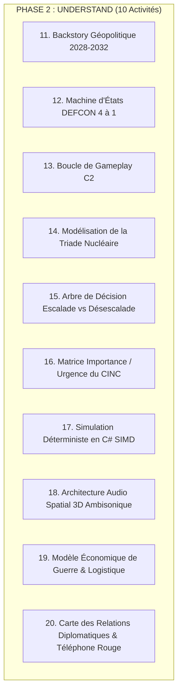
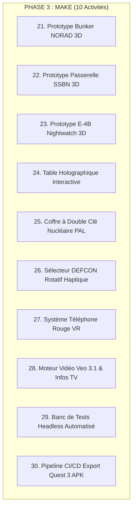

# 🎖️ SESSION DE DESIGN THINKING : WAR COMMAND VR (DEFCON 4 ➔ DEFCON 1)
## 30 Activités Structurées LUMA pour Simulation de Guerre Stratégique AA sur Meta Quest 3 & Godot 4.7
*Auteur : Équipe d'Ingénierie Système & Swarm d'Architectes Antigravity / SAFe*  
*Projet : `vrarmygame` (Godot 4.7 Mono / C# .NET 8 / OpenXR Quest 3)*  
*Branche : `feature/aa-defcon-vr-wargame`*

---

## 🧭 Sommaire Exécutif & Vision du Produit
**War Command VR** plonge le joueur dans la peau d'un **Général Commandant Suprême (CINC)** confronté à l'embrasement d'un conflit mondial majeur entre 2028 et 2032. 

Loin d'un jeu d'arcade classique, il s'agit d'une **simulation réaliste AA de guerre interarmées multi-domaines (Terre, Air, Mer, Espace, Cyber/Guerre Électronique)** vécue depuis trois théâtres de commandement immersifs au choix :
1. **Le Bunker Souterrain Profond** (Site R / Raven Rock / Cheyenne Mountain NORAD) : Béton brut, portes anti-souffle de 25 tonnes, barres lumineuses DEFCON, téléphones rouges chiffrés, cartes murales tactiques.
2. **Le Poste de Commandement Aéroporté Stratégique (E-4B Nightwatch "Doomsday Plane" / E-6B Mercury TACAMO)** : Turbulences atmosphériques réelles, vibrations des 4 réacteurs CF6, baie de transmission très basse fréquence (VLF) filaire de 8 km pour communiquer avec les sous-marins sous les glaces polaires.
3. **Le Sous-Marin Nucléaire Lanceur d'Engins (SSBN Classe Ohio / Columbia / Vanguard)** : Atmosphère rouge tamisée, acoustique hydrophone sous-marine, analyseur de spectre en cascade sonar, sas de lancement de missiles balistiques Trident II D5 et torpilles Mk 48 ADCAP.

Le conflit progresse impitoyablement selon l'escalade militaire réelle : **DEFCON 4 (Double Take) ➔ DEFCON 3 (Round House) ➔ DEFCON 2 (Fast Pace) ➔ DEFCON 1 (Cocked Pistol)**.

---

# 👁️ PARTIE I : LES 10 ACTIVITÉS « LOOK » (OBSERVER & ENQUÊTER)

```mermaid
graph LR
    subgraph LOOK["PHASE 1 : LOOK (10 Activités)"]
        L1["1. Empathie Commandant Suprême"]
        L2["2. Analyse Ergonomique Quest 3"]
        L3["3. Benchmark Simulateurs Militaires"]
        L4["4. Doctrine C4ISR Réelle"]
        L5["5. Taxonomie Menaces Hypersoniques & ASAT"]
        L6["6. Acoustique Guerre Sous-Marine"]
        L7["7. Psycho-Sociologie Panique Nucléaire"]
        L8["8. Cartographie Capteurs 6 Spectres"]
        L9["9. Ethnographie des Quarts de Nuit NORAD"]
        L10["10. Analyse Défaillances VR & Cinétose"]
    end
```



### Activité 1 : Carte d'Empathie du Commandant Suprême (Bunker / Sub / Plane)
*   **Ce qu'il ressent** : Le poids écrasant de la responsabilité (la vie de centaines de millions de civils), la claustrophobie et l'isolement du bunker souterrain ou de l'appareil à 35 000 pieds.
*   **Ce qu'il entend** : Les cliquetis des téléscripteurs chiffrés EAM (Emergency Action Message), le ronronnement lourd des turbines de ventilation NBC, le sifflement radio en onde courte, le klaxon hurlant lors d'un passage DEFCON.
*   **Ce qu'il voit** : Une table holographique 3D projetant des cônes d'interception radar, des traces orbitales de satellites espions, des départs de feu balistiques détectés par infrarouge thermique SBIRS.
*   **Douleurs majeures (Pains)** : Surcharge cognitive lors d'une attaque saturante par drones, fausses alertes de cyber-leurrage, latence de décision en secondes.
*   **Gains recherchés (Gains)** : Clarté absolue de la situation tactique, sensation physique viscérale des commandes (clés PAL réelles, combiné téléphonique lourd, boutons rétroéclairés tactiles).

### Activité 2 : Étude Ergonomique et Biomécanique Meta Quest 3 (OpenXR)
*   **Fréquence d'images cible** : 72 Hz / 90 Hz stable sans décrochage de frame (`0 reprojection drop`).
*   **Interactions gestuelles naturelles** :
    *   *Direct Touch & Poke* : Toucher physique des interrupteurs à bascule protégés par capuchon rouge.
    *   *Grab & Rotate* : Tourner la clé de tir nucléaire physique (rotation 90° avec haptique de résistance).
    *   *Distance Laser Pick & Raycast* : Sélection à distance sur la table holographique géante.
    *   *Two-Hand Spatial Pinch* : Zoom et rotation fluide de la sphère planétaire 3D sans déclencher de nausée spatiale.

### Activité 3 : Benchmark Comparatif des Simulateurs Mondiaux
*   *Command: Modern Operations (CMO)* : Modèle de données balistiques et RCS exceptionnel mais austère (interface tableur 2D).
*   *Defcon: Everybody Dies (Introversion)* : Ambiance sonore glaçante et tension psychologique parfaite.
*   *VTOL VR* : Référence absolue de l'interaction cockpit physique haptique sans manette externe.
*   *Nuclear Option* : Aérodynamique semi-réaliste et dynamique d'explosion nucléaire impressionnante.
*   *IronWolf VR* : Immersion tactile sous-marine coopérative.
*   *Synthèse War Command VR* : Fusionner la profondeur balistique de CMO avec la physicalité tactile de VTOL VR et la dramaturgie glaçante de Defcon.

### Activité 4 : Analyse de la Doctrine Militaire C4ISR Multi-Domaines
*   **Chaîne de destruction (Kill-Chain F2T2EA)** : *Find, Fix, Track, Target, Engage, Assess*.
*   **Intégration capteurs 2028–2032** : Fusion temps réel des flux de drones autonomes (Loyal Wingman), constellations de radars à synthèse d'ouverture LEO (SAR), bouées acoustiques SOSUS et stations terrestres OTH (Over-the-Horizon).

### Activité 5 : Taxonomie des Vecteurs d'Attaque Hypersoniques et Stellaires
*   **Planeurs Hypersoniques (HGV - Mach 15-27)** : Trajectoire atmosphérique non-balistique sinueuse échappant aux radars traditionnels.
*   **Missiles de Croisière Scramjet** : Vol rasant supersonique anti-navire.
*   **Armes Anti-Satellites (ASAT)** : Missiles à ascension directe et lasers d'aveuglement aveuglant les satellites de détection thermique précoce.

### Activité 6 : Étude Acoustique et Thermocline de la Guerre Sous-Marine
*   **Physique de la couche thermique (Thermocline)** : Les sous-marins plongent sous la couche de mélange pour dévier les ondes sonar actives.
*   **Zones de convergence acoustique (CZ)** : Propagation des bruits de cavitation en arcs concentriques tous les 55 km.

### Activité 7 : Psycho-Sociologie du Commandement Nucléaire et Règle des Deux Hommes
*   **Two-Man Rule (Règle des deux personnes)** : Aucun ordre d'attaque stratégique ne peut être exécuté par un seul opérateur isolé.
*   **Codes PAL (Permissive Action Link)** : Déchiffrement de chaînes d'authentification alphanumériques sous pression extrême.

### Activité 8 : Étude de Détection Multi-Spectrale 6 Spectres
1. *Radar Actif 3D* (détection dépendante de la surface équivalente radar - RCS en racine quatrième).
2. *Radar Passif / ESM* (écoute des émissions ennemies sans émettre d'onde).
3. *Infrarouge Thermique FLIR* (détection de panaches de moteurs et frottement hypersonique).
4. *Capteurs Optiques Visuels HD*.
5. *Acoustique / Sonar Actif-Passif*.
6. *Capteurs Magnétiques MAD* (détection d'anomalies de coque métallique submergée).

### Activité 9 : Immersion Ethnographique des Postes de Commandement NORAD
*   Observation des protocoles de transmission radio codés (brevity codes), de la hiérarchie militaire stricte, et du formalisme des briefings SITREP (Situation Report) de 60 secondes.

### Activité 10 : Analyse des Défaillances VR et Prévention de la Cinétose
*   Dans les jeux de stratégie VR, les déplacements brutaux de caméra créent des conflits vestibulaires.
*   *Solution War Command VR* : Le joueur est physiquement ancré dans une pièce solide (bunker, cabine d'avion ou passerelle de sous-marin). Seule la table holographique au centre bouge, garantissant **zéro cinétose (0% motion sickness)**.

---

# 🧠 PARTIE II : LES 10 ACTIVITÉS « UNDERSTAND » (SYNTHÉTISER & MODÉLISER)



### Activité 11 : La Chronique Historique (Backstory Détaillée)

#### *L'Origine du Conflit : La Fracture Silencieuse (2028–2029)*
En octobre 2028, à la suite de tensions croissantes autour du détroit de Taïwan, du corridor de Suwalki en mer Baltique et des routes maritimes dégelées de l'Arctique, une opération de sabotage sous-marine non revendiquée sectionne simultanément 14 câbles sous-marins à fibre optique reliant l'Amérique du Nord à l'Europe et à l'Asie. Au même instant, trois satellites d'alerte avancée subissent une impulsion laser aveuglante depuis le continent eurasiatique.

Le Président active les Directives de Continuité du Gouvernement (PEAD-99) et ordonne au Commandant Suprême de rejoindre le Poste de Commandement Secret.

```
┌─────────────────────────────────────────────────────────────────────────────┐
│ 📅 CALENDRIER D'ESCALADE OPÉRATIONNELLE                                      │
├─────────────────────────────────────────────────────────────────────────────┤
│ • 14 Octobre : Sabotage des câbles sous-marins & cyber-attaque sur le réseau │
│ • 18 Octobre : DEFCON 4 déclaré. Mobilisation des unités de renseignement.   │
│ • 22 Octobre : Incident de tir en mer Noire & détroit d'Ormuz. DEFCON 3.    │
│ • 27 Octobre : Frappes hypersoniques sur les groupes aéronavals. DEFCON 2. │
│ • 01 Novembre : Détection de salves ICBM sibériennes. DEFCON 1 IMMINENT.    │
└─────────────────────────────────────────────────────────────────────────────┘
```

### Activité 12 : Machine d'États Systémique DEFCON 4 ➔ DEFCON 1

| Niveau DEFCON | Nom de Code | Posture Militaire Réelle | Conséquences en Jeu | Musique & Ambiance |
| :--- | :--- | :--- | :--- | :--- |
| **DEFCON 4** | *Double Take* | Renseignement renforcé, sécurité accrue des bases. | Surveillance satellite, vol de drones de reconnaissance, patrouilles maritimes. | Nappe ambiante sourde, bruits de serveurs, lumières blanches/vertes. |
| **DEFCON 3** | *Round House* | Forces aériennes prêtes à décoller en 15 minutes. | Dispersion des bombardiers B-21, sorties des SNLE en haute mer, brouillage radar activé. | Sons de radio tactique saccadés, gyrophares jaunes d'avertissement. |
| **DEFCON 2** | *Fast Pace* | Forces armées prêtes à engager le combat en 6 heures. | Frappes cinétiques conventionnelles, duels de missiles navals, combat aérien BVR, défenses sol-air Patriot/S-400 actives. | Percussions lourdes, alarme intermittente, lumières ambrées d'urgence. |
| **DEFCON 1** | *Cocked Pistol* | État d'alerte maximale, engagement nucléaire autorisé. | Déverrouillage des coffres PAL, activation des silos ICBM Sentinel, salves SLBM Trident, missiles d'interception THAAD/GBI. | Klaxon d'alerte générale strident, éclairage rouge sang clignotant, pulsation cardiaque. |

### Activité 13 : La Boucle de Gameplay C2 (Command & Control)
1. **Écouter & Visualiser** : Analyser les flux de contacts radar/sonar sur la table holographique 3D.
2. **Évaluer la Menace** : Identifier le profil (bombardier furtif, missile de croisière, sous-marin en plongée).
3. **Engager ou Manœuvrer** : Attribuer des cibles aux escadrilles de chasse, ordonner un tir de barrage ou allumer un brouilleur de guerre électronique.
4. **Subir & Réagir** : Gérer les pertes, ordonner des ravitaillements en vol d'urgence ou déplacer les unités menacées.

### Activité 14 : Modélisation Physique Réelle de la Triade Nucléaire
*   **Vecteur Terrestre (ICBM)** : Vol balistique exoatmosphérique à Mach 22 (apogée 1 200 km, temps de vol transatlantique 28 minutes).
*   **Vecteur Océanique (SLBM)** : Lancement sous-marin à trajectoire tendue (temps de vol réduit à 12-15 minutes, invulnérabilité au premier coup).
*   **Vecteur Aérien (Bombardiers Stratégiques B-21 / B-52)** : Pénétration furtive à basse altitude, largage de missiles de croisière stand-off (LRSO).

### Activité 15 : Arbre de Décision : Frappe Préventive vs Riposte Graduée
Le joueur peut choisir entre :
*   *Option Alpha (Contre-Forces)* : Frapper uniquement les silos, bases aériennes et centres de commandement adverses pour désarmer l'ennemi.
*   *Option Bêta (Contre-Valeurs)* : Frapper les centres économiques et industriels (destruction mutuelle assurée).
*   *Option Gamma (Désescalade par la Force)* : Frappe de démonstration électromagnétique (HEMP) pour neutraliser les réseaux sans faire de victimes civiles immédiates.

### Activité 16 : Matrice de Priorisation du Général (Eisenhower Militaire)
*   *Urgent & Critique* : Salve de missiles hypersoniques anti-porte-avions en approche (réaction requise en < 45 secondes).
*   *Non-Urgent mais Stratégique* : Positionnement discret des sous-marins d'attaque dans les détroits arctiques.

### Activité 17 : Moteur de Simulation C# SIMD (.NET 8.0)
*   Calcul vectorisé des portées radar selon l'équation en racine quatrième :
    $$R_{\text{eff}} = R_0 \cdot \left(\frac{\sigma}{\sigma_0}\right)^{\frac{1}{4}}$$
*   Gestion des 5 000+ entités militaires en mémoire compacte Structure-of-Arrays (SoA) sans garbage collector à 10 Hz constant.

### Activité 18 : Architecture Audio Spatialisée 3D (Meta Quest 3)
*   Utilisation de profils HRTF réalistes pour spatialiser chaque son d'interrupteur, chaque cliquetis d'horloge de compte à rebours, et les communications radio émanant des haut-parleurs du plafond du bunker.

### Activité 19 : Logistique et Chaîne d'Approvisionnement
*   Chaque tir de missile Patriot PAC-3 ou SM-6 puise dans les stocks stratégiques limités. Le joueur doit arbitrer entre consommer ses munitions d'élite ou risquer des dégâts sur ses infrastructures.

### Activité 20 : Le Téléphone Rouge et Négociations de Crise
*   Possibilité de décrocher le combiné physique pour tenter d'obtenir un cessez-le-feu de 60 secondes ou proposer un échange diplomatique avant l'irréversible DEFCON 1.

---

# 🛠️ PARTIE III : LES 10 ACTIVITÉS « MAKE » (PROTOTYPER & CONSTRUIRE)



### Activité 21 : Prototypage de l'Environnement 1 - Bunker NORAD
*   Murs en béton armé texturés, console de contrôle métallique vintage avec jauges analogiques et écrans cathodiques CRT affichant le statut IADS.
*   Grand écran central projetant le globe terrestre avec lignes de partage géopolitiques.

### Activité 22 : Prototypage de l'Environnement 2 - Sous-Marin Nucléaire
*   Plafond bas, tuyauteries et vannes réalistes, lumière rouge de combat nocturne.
*   Station de périscope optique fonctionnelle avec grossissement x12 et réticule stadimétrique.

### Activité 23 : Prototypage de l'Environnement 3 - Doomsday Plane (E-4B)
*   Cabine de commandement avec fenêtres blindées électro-chromatiques, vibrations physiques haptiques dans les manettes lors des turbulences.
*   Moniteurs avioniques de suivi des tankers de ravitaillement KC-46.

### Activité 24 : La Table Holographique Tactique 3D (The War Table)
*   Projection stéréoscopique flottant au-dessus du sol.
*   Affichage en temps réel des unités représentées par des symboles normalisés STANAG NATO (diamants hostiles rouges, rectangles amis bleus).
*   Tracé des trajectoires balistiques en arcs paraboliques brillants.

### Activité 25 : Mécanisme d'Armement Nucléaire à Double Clé Physique
*   Coffre sécurisé nécessitant la saisie d'un code PAL à 8 caractères sur un clavier numérique mécanique.
*   Tourner simultanément deux clés situées à distance pour déclencher l'autorisation de tir DEFCON 1.

### Activité 26 : Le Sélecteur Rotatif DEFCON à Clic Haptique
*   Gros bouton rotatif en bakélite permettant de passer manuellement ou de valider les seuils DEFCON 4 ➔ DEFCON 3 ➔ DEFCON 2 ➔ DEFCON 1 avec une secousse haptique prononcée sur le contrôleur Touch Pro du Quest 3.

### Activité 27 : Le Téléphone Rouge Chiffré
*   Modèle 3D fidèle du combiné téléphonique rouge lourd des années de guerre froide.
*   Prise en main naturelle : lorsqu'on approche le combiné de l'oreille, le mixage audio bascule vers un canal radio direct filtré bande étroite (300 Hz - 3 400 Hz) avec bruits de friture réalistes.

### Activité 28 : Intégration du Mur Vidéo d'Information en Continu (Veo 3.1 / Gemini)
*   Écrans de télévision fixés aux cloisons diffusant des flashs spéciaux de chaînes internationales (CNN, BBC World, Reuters) réagissant aux événements de la bataille en temps réel.

### Activité 29 : Banc de Tests Automatisé Headless Godot 4.7
*   Validation de la simulation sans affichage graphique (`--headless`) pour vérifier en quelques secondes :
    *   Le chargement de l'encyclopédie SQLite (`wargame.db`).
    *   La physique balistique et l'interception de drones par faisceau micro-ondes HPM.
    *   L'intégrité de la machine d'états DEFCON.

### Activité 30 : Pipeline d'Export et Optimisation Meta Quest 3
*   Configuration de l'export Android OpenXR (`export_presets.cfg`) avec compression de texture ASTC, Fixed Foveated Rendering (FFR niveau 3 dynamique), et shader mobile multi-passe optimisé pour GPU Adreno 740.

---

## 🚀 Prochaines Étapes : Transition vers le Processus SAFe
Ces 30 activités de Design Thinking fournissent la fondation humaine, technologique et tactique complète. Elles sont désormais traduites en spécifications techniques SAFe dans le document [`docs/02_SAFE_PI01_PROGRAM_INCREMENT_SPEC.md`](file:///c:/dev/vrarmygame/docs/02_SAFE_PI01_PROGRAM_INCREMENT_SPEC.md).
