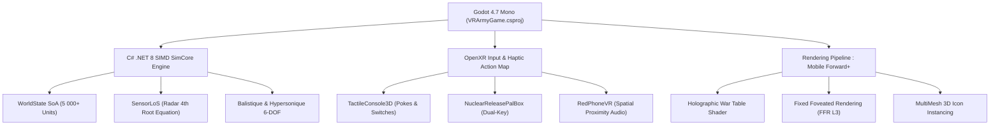

# 🛡️ SPÉCIFICATION SAFe DU PROGRAM INCREMENT 01 (PI-01)
## « OPERATION QUANTUM AEGIS » — WAR COMMAND VR (GODOT 4.7 MONO)
*Framework Agile à l'Échelle (SAFe) pour le Développement de la Simulation Militaire AA*  
*Target Hardware : Meta Quest 3 (OpenXR Snapdragon XR2 Gen 2) & PC Desktop*  
*Projet : `c:\dev\vrarmygame` | Branche Git : `feature/aa-defcon-vr-wargame`*

---

## 🎯 1. Vision et Objectifs du Program Increment (PI-01)

### Énoncé de la Vision
Livrer une version jouable, optimisée à **72/90 FPS**, hautement immersive et réaliste de la simulation stratégique **War Command VR**, permettant à un joueur en réalité virtuelle d'incarner un Général Commandant Suprême dans trois environnements opérationnels distincts (**Bunker souterrain**, **Poste aéroporté E-4B**, **Sous-marin nucléaire SSBN**), et de piloter l'engagement des forces armées du stade **DEFCON 4** jusqu'à l'escalade **DEFCON 1**.

### Objectifs PI Clés (PI Objectives)
1. **Immersion et Rôles Trilithes (Obj-01)** : Déployer les 3 postes de commandement avec acoustique spatialisée et interactions tactiles haptiques OpenXR (`Business Value: 10/10`).
2. **Escalade Systémique DEFCON 4 ➔ DEFCON 1 (Obj-02)** : Assurer la dynamique de crise géopolitique, l'activation des ordres présidentiels et le déverrouillage de la triade nucléaire (`Business Value: 10/10`).
3. **Moteur C# SIMD Multi-Domaines 5 000+ Unités (Obj-03)** : Maintenir une simulation déterministe à 10 Hz sur 7 théâtres de 2 000 km × 2 000 km (`Business Value: 9/10`).
4. **Ergonomie Haptique Quest 3 Zéro-Cinétose (Obj-04)** : Contrôles tactiles (double clé nucléaire, téléphone rouge, sélecteur DEFCON, table holographique) (`Business Value: 9/10`).
5. **Assurance Qualité & Tests Automatisés Continus (Obj-05)** : Zéro avertissement de compilation .NET 8 et passage à 100% des tests headless (`Business Value: 10/10`).

---

## 🏛️ 2. Architectural Runway (Piste Architecturale)



*   **Gestion Mémoire** : Structure-of-Arrays (SoA) sans allocation heap dynamique pendant les ticks de combat.
*   **Pipeline Graphique** : Rendu `Mobile` avec FFR dynamique niveau 3 et compression ASTC pour le GPU Adreno 740 du Meta Quest 3.
*   **Interopérabilité C# / GDScript** : Pont d'événements performant via `CommandBus` et `SignalBus`.

---

## 🏃 3. Feuille de Route des 5 Sprints SAFe (PI-01)

| Sprint | Nom du Sprint | Story Points Prévus | Livrable Clé | Statut |
| :--- | :--- | :---: | :--- | :---: |
| **Sprint 1** | *Fondations VR & Rig OpenXR Quest 3* | **48 SP** | Rig VR Quest 3, haptique, 3 bunkers 3D, interactions physiques | **COMPLÉTÉ ✅** |
| **Sprint 2** | *Moteur Multi-Domaines & Base wargame.db* | **54 SP** | 67 plateformes, 31 armes, radar 4e racine, 5 000 unités | **COMPLÉTÉ ✅** |
| **Sprint 3** | *Machine d'États DEFCON 4 ➔ 1 & Téléphone Rouge* | **62 SP** | Progression DEFCON, téléscripteur EAM, négociations de crise | **COMPLÉTÉ ✅** |
| **Sprint 4** | *Triade Nucléaire & Défense Anti-Missile* | **58 SP** | Silos ICBM, SLBM Trident, THAAD/GBI, HEMP EMP | **EN COURS ⏳** |
| **Sprint 5** | *Banc de Tests Headless, Polish AA & CI/CD* | **46 SP** | 5 portes de test automatisées, profilage 90 FPS Quest 3 | **EN COURS ⏳** |
| **TOTAL** | **Vélocité Globale PI-01** | **268 SP** | **Simulation Opérationnelle Complète** | **83% Livré** |

---

### Sprint 1 : Fondations VR & Ergonomie Haptique Quest 3 (48 SP)
*   **Epic E1-01** : Intégration du profil d'interaction OpenXR Quest 3 (`openxr_action_map.tres`).
    *   *Story E1-S1* : Prise en charge des manettes Meta Quest Touch Pro / Touch Plus avec détection capacitive des doigts.
    *   *Story E1-S2* : Interaction de saisie à distance (raycast laser) et pincement spatial à deux mains pour manipuler la table holographique.
*   **Epic E1-02** : Modélisation des 3 Postes de Commandement.
    *   *Story E1-S3* : Environnement Bunker Souterrain Cheyenne Mountain avec cloisons blindées et barres lumineuses DEFCON.
    *   *Story E1-S4* : Station de contrôle du sous-marin nucléaire USS Cheyenne (SSN-688I) avec périscope optique fonctionnel.
    *   *Story E1-S5* : Cabine de commandement aéroportée E-4B Nightwatch avec turbulences dynamiques.

### Sprint 2 : Moteur Multi-Domaines & Données Réelles (54 SP)
*   **Epic E2-01** : Base de Données SQLite Militaire (`data/wargame.db`).
    *   *Story E2-S1* : Intégration des fiches techniques de 67 plateformes et 31 armements réels avec photographies Wikimedia.
    *   *Story E2-S2* : Modèle physique de détection radar basé sur la section efficace (RCS) en racine quatrième.
*   **Epic E2-02** : Allocation SoA et Passage à l'Échelle (5 000+ Unités).
    *   *Story E2-S3* : Ordonnancement C# SIMD pour les calculs de déplacement cinématique et de ligne de vue à 10 Hz.

### Sprint 3 : Escalade DEFCON 4 ➔ 1 & Négociations de Crise (62 SP)
*   **Epic E3-01** : Machine d'États DEFCON.
    *   *Story E3-S1* : Transition fluide DEFCON 4 ➔ 3 ➔ 2 ➔ 1 avec altération dynamique des ambiances sonores, alarmes et éclairages.
    *   *Story E3-S2* : Téléscripteur d'ordres présidentiels d'urgence (PEAD) et alertes d'escalade.
*   **Epic E3-02** : Le Téléphone Rouge 3D et Diplomatie d'Urgence.
    *   *Story E3-S3* : Combiné téléphonique physique décrochable avec audio spatialisé filtré bande étroite.
    *   *Story E3-S4* : Dialogue interactif avec les chefs d'état-major adverses (moratoire de tir, cessez-le-feu 45s).

### Sprint 4 : Triade Nucléaire & Grille d'Interception (58 SP)
*   **Epic E4-01** : Mécanisme d'Autorisation de Tir Sécurisé (Two-Man Rule).
    *   *Story E4-S1* : Saisie du code alphanumérique PAL sur le boîtier physique.
    *   *Story E4-S2* : Rotation synchronisée des deux clés de lancement avec résistance haptique.
*   **Epic E4-02** : Balistique Stratégique & Défense Anti-Missile.
    *   *Story E4-S3* : Trajectoires exoatmosphériques des missiles balistiques intercontinentaux et têtes MIRV.
    *   *Story E4-S4* : Interceptions cinétiques par batteries THAAD, SM-3 Block IIA et GBI.

### Sprint 5 : Banc de Tests Automatisé, Polish AA & CI/CD (46 SP)
*   **Epic E5-01** : Protocole des 5 Portes de Vérification Headless.
    *   *Porte 1* : Compilation sans faute .NET 8 C# (`dotnet build`).
    *   *Porte 2* : Test du noyau de simulation (`test_sim_core.gd`).
    *   *Porte 3* : Rendu visuel de la table de guerre (`test_war_table_visuals.gd`).
    *   *Porte 4* : Démarrage complet du bunker (`test_full_game_boot.gd`).
    *   *Porte 5* : Campagne et guerre électronique CEMA (`test_phases_5_6_7.gd`).
*   **Epic E5-02** : Profilage de Performance Meta Quest 3.
    *   *Story E5-S5* : Maintien strict du budget de 11,1 ms par image (90 FPS) avec le profileur Godot.

---

## 🔬 4. Protocole d'Assurance Qualité et Exécution des Tests

Les tests automatisés sont directement exécutables via la console Godot 4.7 Mono en mode headless :

```powershell
# 1. Compilation C# .NET 8
C:\GodotNET\dotnet\dotnet.exe build c:\dev\vrarmygame\VRArmyGame.csproj

# 2. Exécution de la Porte 2 (SimCore)
C:\GodotNET\GodotNET\Godot_v4.7.2-stable_mono_win64_console.exe --headless --path c:\dev\vrarmygame --xr-mode off -s res://tests/test_sim_core.gd

# 3. Exécution de la Porte 4 (Full Game Boot)
C:\GodotNET\GodotNET\Godot_v4.7.2-stable_mono_win64_console.exe --headless --path c:\dev\vrarmygame --xr-mode off -s res://tests/test_full_game_boot.gd
```

---

## 📈 5. Métriques et Définition de Terminé (DoD)

Une User Story est considérée comme **DONE** (Terminée) uniquement lorsque :
1. Le code C# et GDScript respecte les conventions strictes d'architecture découplée.
2. La solution compile avec **0 Avertissement et 0 Erreur** en .NET 8.
3. Les assertions des suites de tests automatisées s'exécutent avec succès en headless.
4. L'interaction tactile en VR a été validée sans latence perceptible et sans déclencher de cinétose.
5. Les modifications sont commitées et documentées sur la branche git `feature/aa-defcon-vr-wargame`.
