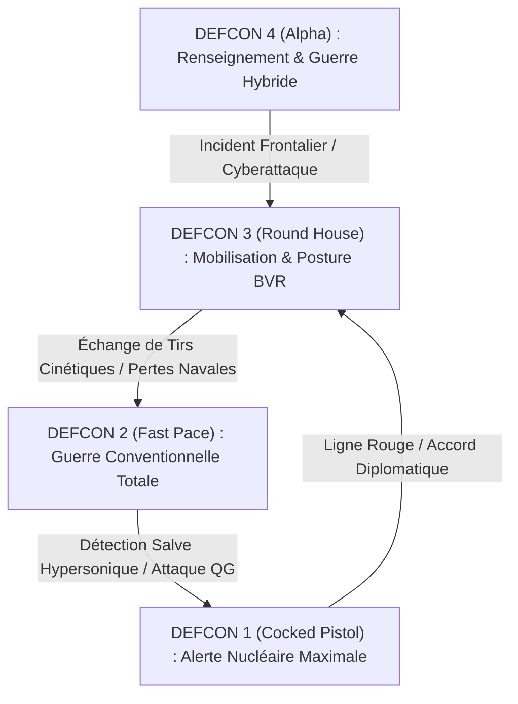

# Spécification SAFe PI 02 / Sprint 2 : Escalade DEFCON 4 à 1, Tri-Command & Backstory 2028

## 1. Contexte & Démarche Design Thinking
Dans le cadre de la méthodologie Design Thinking (Double Diamant LUMA) appliquée au simulateur militaire VR/PC Meta Quest 3, le Sprint 2 élève l'expérience au niveau d'un jeu de stratégie d'état-major de classe **AA**.

Le joueur n'est plus seulement un observateur tactique : il incarne le **Général en Chef des Opérations Stratégiques**, confronté à une escalade mondiale dynamique (2028) qu'il peut gérer depuis trois environnements de commandement réalistes.

---

## 2. Backstory Géopolitique : La Crise Mondiale de 2028 ("Operation Pacific Shield & Suwalki Breach")

### Chronologie des Événements Déclencheurs (Timeline) :
1. **Janvier 2028 (Guerre Hybride & CEMA)** : Coupure inexpliquée de 4 câbles sous-marins de télécommunication en mer Baltique et dans le détroit de Luçon. Attaque cybernétique de type "Wiper" sur les terminaux de contrôle des réseaux électriques d'Europe orientale.
2. **Mars 2028 (Incident Maritime du Banc Thomas)** : Une frégate de la coalition internationale subit un tir de laser aveuglant et un abordage par milice maritime. Deux drones de surveillance MQ-9A Reaper sont abattus par des missiles sol-air à longue portée dans l'espace aérien international.
3. **Mai 2028 (Activation du DEFCON 3)** : Mobilisation générale des forces conventionnelles, sortie silencieuse des sous-marins nucléaires lanceurs d'engins (SNLE / SSBN) sous les glaces de l'Arctique et dans la fosse des Mariannes.
4. **Été 2028 (Escalade Cinétique DEFCON 2 puis Menace DEFCON 1)** : Frappes de missiles hypersoniques conventionnels contre les bases avancées, combats BVR massifs et course contre la montre diplomatique via la "Ligne Rouge" pour éviter l'apocalypse thermo-nucléaire.

---

## 3. Matrice d'Escalade Réaliste : DEFCON 4 à DEFCON 1

| Niveau DEFCON | Nom de Code OTAN | Règles d'Engagement (ROE) | Capacités & Systèmes Actifs | Musique & Ambiance Bunker |
| :--- | :--- | :--- | :--- | :--- |
| **DEFCON 4** | *Double Take* | Furtivité stricte, surveillance passive, cyber-espionnage, tirs interdits sans autorisation explicite du Président. | Drones SIGINT/ELINT, surveillance satellite, patrouilles de chasse à distance de sécurité (50 km). | Ambiance tamisée bleue, bruits feutrés de télétypes et de ventilateurs de serveurs. |
| **DEFCON 3** | *Round House* | Autorisation des tirs BVR d'auto-défense après verrouillage radar hostile confirmé. | Déploiement des IADS (S-400 / Patriot), patrouilles de combat continu (CAP), ravitailleurs en vol en hippodrome. | Éclairage blanc d'intensité maximale, horloge de théâtre en compte à rebours, alertes sonores modérées. |
| **DEFCON 2** | *Fast Pace* | Guerre ouverte tous domaines (air, terre, mer, cyber, espace). Frappes de profondeur autorisées. | Frappes de saturation JASSM-ER / Kalibr, guerre électronique offensive, meutes de drones FPV / CCA. | Sirène d'évacuation intermittente, éclairage ambre pulsé, écrans muraux saturés de pistes hostiles. |
| **DEFCON 1** | *Cocked Pistol* | Riposte stratégique maximale. Autorisation de déverrouillage des codes nucléaires PAL (*Permissive Action Links*). | Missiles balistiques intercontinentaux (ICBM / SLBM Trident II / Bulava), boucliers ABM (THAAD, SM-3). | Alerte rouge tournante d'urgence, activation de la valise nucléaire, musique dramatique orchestrale à faible tempo. |

---

## 4. Les Trois Postes de Commandement Alternatifs ("Tri-Command")

Le joueur peut basculer son poste de commandement physique ou démarrer sa campagne depuis l'un des trois sièges stratégiques :

### Station A : Le Bunker Stratégique Profond (Raven Rock / Cheyenne Mountain)
- **Localisation** : 600 mètres sous un dôme de granite, résistant à une explosion thermo-nucléaire de 5 mégatonnes.
- **Environnement VR** : Table de guerre holographique centrale géante, baies de serveurs C4ISR, écrans muraux de situation géostratégique mondiale, combiné du Téléphone Rouge.
- **Style de Jeu** : Vue d'ensemble macroscopique, coordination de tous les théâtres mondiaux, gestion économique et industrielle.

### Station B : Le Poste Central du Sous-Marin Nucléaire SSBN (Classe Columbia / Ohio)
- **Localisation** : Immersion à -180 mètres sous la thermocline dans l'océan Pacifique ou sous la banquise.
- **Environnement VR** : Éclairage rouge d'alerte sous-marine, console acoustique avec cascade de chutes d'eau sonar passif, périscope d'attaque interactif, sas d'armes et tubes de missiles balistiques.
- **Style de Jeu** : Furtivité extrême, guerre de l'ombre, gestion du bruit acoustique (cavitation, transitoires), tirs de torpilles lourdes et dissuasion finale.

### Station C : Le Poste de Commandement Aérien E-4B "Doomsday Plane" (NAOC)
- **Localisation** : Boeing 747 militarisé en vol continu à 38 000 pieds avec ravitaillement en vol continu par KC-46.
- **Environnement VR** : Cabine pressurisée avec hublots blindés anti-flash nucléaire, légère inclinaison en virage et turbulences d'air réalistes, baie de transmission VLF (antenne filaire de 8 km déroulée pour contacter les sous-marins).
- **Style de Jeu** : Mobilité absolue, invulnérabilité aux frappes au sol, risque d'interception par chasseurs ennemis à longue portée (J-20 / MiG-31BM).

---

## 5. Epics & User Stories du Sprint 2 (SAFe PI 02)

### Epic S2-01 : Moteur d'Escalade DEFCON Dynamique & Musique de Crise
- **User Story S2-01.1** : En tant que Général, je veux que le niveau de DEFCON évolue dynamiquement en fonction du ratio de pertes, des frappes sur le territoire national et des alertes de détection balistique.
- **User Story S2-01.2** : En tant que joueur VR, je veux que l'ambiance sonore, l'éclairage de la pièce (bleu $\rightarrow$ blanc $\rightarrow$ ambre $\rightarrow$ rouge stroboscopique) et les bruits d'ambiance reflètent immédiatement le passage de DEFCON 4 à DEFCON 1.

### Epic S2-02 : Sélecteur de Station Tri-Command (Bunker / SSBN / Doomsday Plane)
- **User Story S2-02.1** : En tant que joueur, je veux pouvoir choisir mon quartier général au lancement de la campagne ou me relocaliser en cas de destruction imminente du bunker via le bouton d'évacuation d'urgence.
- **User Story S2-02.2** : En tant que joueur dans le poste SSBN, je veux pouvoir observer la surface à travers le périscope optique et entendre les contacts acoustiques sonar.

### Epic S2-03 : IA Stratégique Théâtrale & Frappes Combinées
- **User Story S2-03.1** : En tant que commandant, je veux que l'OPFOR (forces ennemies) orchestre des assauts coordonnés en plusieurs vagues (brouillage CEMA $\rightarrow$ frappe SEAD anti-radar $\rightarrow$ meute de drones saturants $\rightarrow$ frappe de pénétration de chasseurs).
- **User Story S2-03.2** : En tant que joueur, je veux pouvoir ordonner un corridor de frappe d'armes combinées (désignation par drone, tir de missile par frégate au large, guidage terminal par chasseur furtif).
