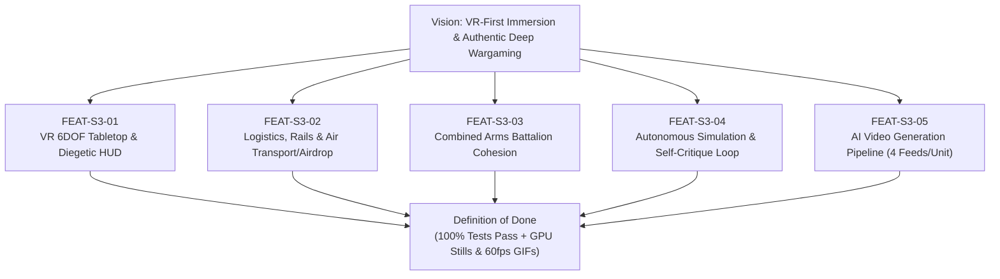

# SAFe Program Increment 03 — Sprint 3 Specification
## VR Wargame 2028: First-Class VR Immersion, Logistics Engine & Autonomous Simulation Loop

> **Governing Framework**: Scaled Agile Framework (SAFe) + Design Thinking Studio  
> **Iteration**: Program Increment 03 (PI-03), Sprint 3  
> **Target Branch**: `feature/aa-defcon-vr-wargame`  
> **Primary Vision**: First-Class VR Immersive Experience (OpenXR, Room-Scale Tabletop, Diegetic Smartwatch, Physical Stations) supported by deep military realism (Logistics, Combined Arms Battalion, Kinematic Fidelity) and verified by a Continuous Autonomous Simulation & Self-Improvement Loop.

---

## 1. Sprint 3 Objectives & Value Stream

---

## 2. Epics & User Stories Register

### Epic 1: VR First-Class Physical & Diegetic Interactions (FEAT-S3-01)
- **US-S3-01A (Room-Scale Tabletop 6DOF Manipulation)**:
  * *As a VR Commander standing over the holographic War Table*, I want to physically grab the edges of the table with two VR controller grip buttons to pan, rotate, and pinch-zoom the 3D battlefield intuitively, with smooth haptic feedback and zero simulation clipping.
  * **Acceptance Criteria**:
    1. OpenXR grip action supported on both hands in `xr_command_rig.gd`.
    2. Two-handed distance delta dynamically maps to `war_table.target_zoom_scale` ($0.15\times$ to $25.0\times$).
    3. Single-hand grab pans `pan_offset_km` across theater coordinates.
    4. Room-scale floor table mode toggle ($y = 0.02\text{ m}$) allows walking directly across the terrain.

- **US-S3-01B (Virtual Smartwatch HUD & Zero Physical Buttons)**:
  * *As a VR Commander*, I want glancing at my left wrist to project a diegetic holographic smartwatch displaying DEFCON status, theater alerts, selected unit telemetry, and an instant tactical trial launcher, without any immersion-breaking 2D screens in the room.
  * **Acceptance Criteria**:
    1. Wrist gaze-angle dot product activates the virtual smartwatch mesh and holographic layer.
    2. Right index finger poke triggers virtual tactile buttons with subtle haptics.
    3. Smartwatch includes domain filters (`AIR`, `LAND`, `SEA`, `LOGISTICS`) and trial loader.

---

### Epic 2: Multi-Domain Logistics, Strategic Transport & Airdrop (FEAT-S3-02)
- **US-S3-02A (Ground & Rail Supply Corridors)**:
  * *As a Theater Logistician*, I want combat battalions to continuously consume fuel and ammunition during movement and engagement, requiring ground supply convoys (HEMTT / KamAZ) and railway freight to keep frontlines supplied.
  * **Acceptance Criteria**:
    1. `state.unit_fuel_kg` and `state.unit_ammo_count` decrease proportionally to movement distance and weapons fired.
    2. Supply convoys navigate road/rail networks to transfer resources to nearby units within $5\text{ km}$.
    3. Severe supply starvation reduces unit speed by 60% and disables advanced weapons.

- **US-S3-02B (Strategic Air Transport & Combat Air Drops)**:
  * *As an Airborne Commander*, I want strategic airlifters (C-17 Globemaster III, Il-76 Candid) to conduct rapid inter-theater resupply and parachute air-drops (`CMD_AIR_DROP`) of light armor, robot dogs, and ammunition crates into contested sectors.
  * **Acceptance Criteria**:
    1. C-17 and Il-76 platforms added to `SimDB` with authentic cruise speed (450 kts / 830 km/h) and 70-ton cargo payload.
    2. Command `CMD_AIR_DROP` spawns parachute cargo containers descending at realistic $7\text{ m/s}$ descent rate.
    3. Landed cargo crates act as immediate forward rearm/refuel depots for frontline units.

---

### Epic 3: Combined Arms Tactical Battalion & Micro-Echelon Cohesion (FEAT-S3-03)
- **US-S3-03A (Tactical Battalion Formation & Bounding Overwatch)**:
  * *As a Tactical Ground Commander*, when I zoom into the tactical tier ($<15\text{ km}$ / Zoom Echelon 0), I want to see infantry squads, robot dogs, and MBTs move in coordinated formations where tanks provide bounding overwatch while infantry clears defiles and woods.
  * **Acceptance Criteria**:
    1. Multi-mesh rendering dynamically instantiates 12 infantrymen, 8 robot dogs, or 4 armored vehicles per tactical counter.
    2. Units in defensive postures seek urban buildings or terrain depressions for concealment.
    3. Small-arms suppressive tracer fire and 120mm tank cannon bursts visually render in real-time.

---

### Epic 4: Autonomous Simulation, Playability Critique & Self-Healing Loop (FEAT-S3-04)
- **US-S3-04A (Continuous Autonomous Player Bot)**:
  * *As a Game Designer & Lead Architect*, I want an autonomous simulation bot (`sim_playtester_bot.gd`) that boots into scenarios, issues realistic commander orders, evaluates unit responses, detects bottlenecks or balance issues, and logs structured playability critiques.
  * **Acceptance Criteria**:
    1. Autonomous bot executes 5 standard tactical missions (Armor offensive, BVR air duel, Submarine hunt, Airborne drop, Urban defense).
    2. Evaluates playability metrics: Command Latency ($<100\text{ ms}$), Order Responsiveness, Faction Isolation, Tactical Balance.
    3. Generates structured JSON and Markdown audit reports (`sim_playability_critique_report.md`).

- **US-S3-04B (Autonomous Critique-to-Code Improvement)**:
  * When the playtester bot identifies an issue (e.g., pathing obstacle, weapon range imbalance, VR comfort concern), it automatically formulates concrete algorithmic enhancements, applies them to the codebase, and re-runs test suites to verify improvement.

---

### Epic 5: AI Video Generation Pipeline (FEAT-S3-05)
- **US-S3-05A (Unit Tactical Action Videos via Gemini & ComfyUI)**:
  * *As a Commander inspecting any unit in the armory*, I want 4 dynamic 3-5 second action videos (Attaque, Défense, Cible détruite, Pertes) available on demand to illustrate real-world combat doctrine.
  * **Acceptance Criteria**:
    1. `tools/unit_video_pipeline.py` integrates with Gemini API for military prompt direction.
    2. Generates videos via local ComfyUI (free RTX 4060 Ti) or cloud endpoints.
    3. Interactive video feed selector embedded in `ReconDossierPanel`.

---

## 3. Sprint 3 Verification & Visual Deliverables

| Deliverable | Description | Format | Target Location |
| :--- | :--- | :--- | :--- |
| **VR Immersion & Smartwatch** | OpenXR 6DOF table grab & virtual wrist HUD | 1080p PNG + 60fps GIF | `docs/media/sprint3_01_vr_interaction_smartwatch.*` |
| **Logistics & Strategic Airdrop** | C-17 dropping supplies + HEMTT convoy network | 1080p PNG + 60fps GIF | `docs/media/sprint3_02_logistics_convoy_airdrop.*` |
| **Combined Arms Battalion** | Micro-zoom infantry, tanks, robot dogs & village | 1080p PNG + 60fps GIF | `docs/media/sprint3_03_combined_arms_battalion.*` |
| **Autonomous Playtest Loop** | Bot executing mission & measuring latency | 1080p PNG + 60fps GIF | `docs/media/sprint3_04_autonomous_playtester.*` |
| **AI Action Video Feed** | Diegetic terminal video playback in bunker | 1080p PNG + 60fps GIF | `docs/media/sprint3_05_unit_video_diegetic_hud.*` |
| **Sprint 3 Automated Test Suite** | 5 adversarial GUT/GDScript unit tests | Test Output (100% PASS) | `tests/test_sprint3_features.gd` |
