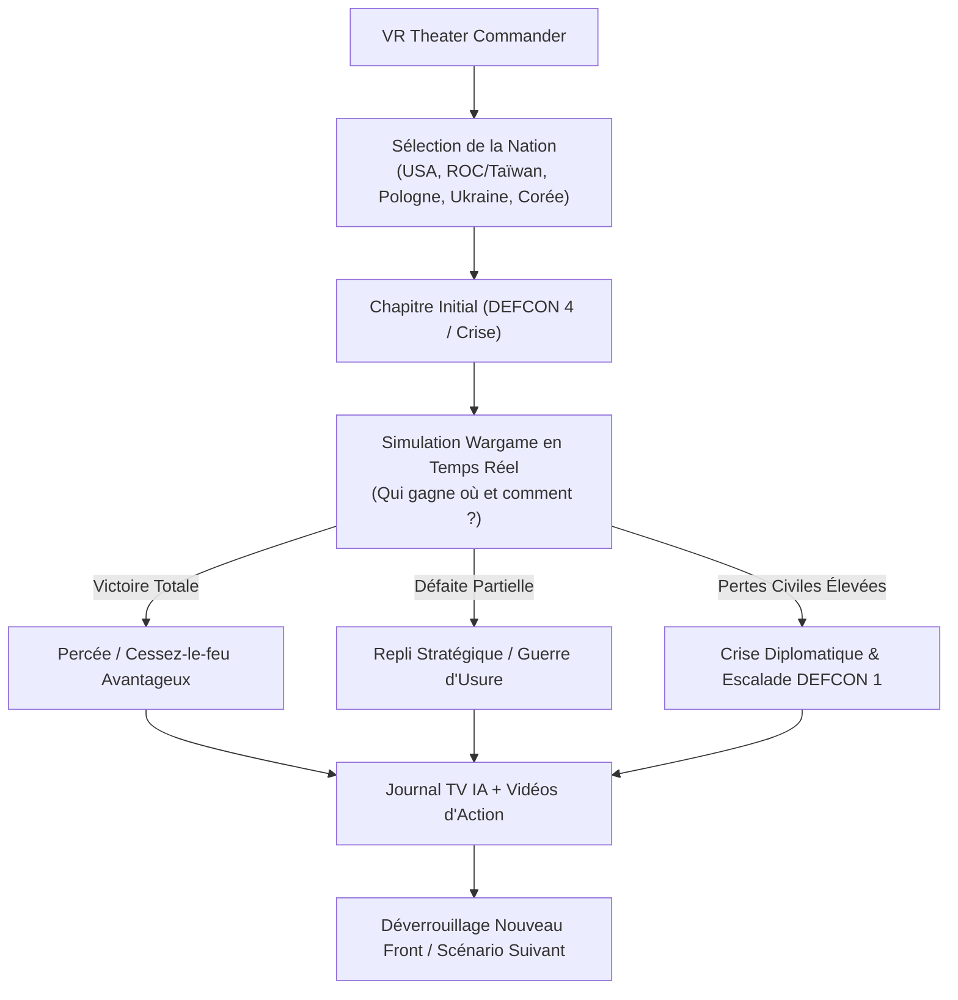

# SAFe Program Increment 04 — Sprint 4 Specification
## Branching Story Trees, Multi-Nation Playability & AI-Generated Narrative Pipeline

> **Iteration**: Program Increment 04 (PI-04), Sprint 4  
> **Commercial Target**: AA High-End VR Simulator ($20–$30 USD Retail Value on Meta Quest Store & SteamVR)  
> **Architecture Core**: SQLite-driven dynamic narrative tree (`campaign_story_nodes`, `campaign_story_edges`, `campaign_nations`), multi-nation campaign branches, simulation-driven outcome evaluation ("who wins where and how"), and AI video/news generation pipeline.

---

## 1. Executive Summary & Design Thinking Context

### Problématique Résolue (Design Thinking) :
- Les jeux de guerre classiques imposent une campagne rigide et linéaire où les victoires ou défaites n'ont aucun impact réel sur le reste du monde.
- **Notre Solution AA** : Le destin géopolitique de 2028 est représenté sous la forme d'un **arbre d'histoires interconnectées (Tree of Mini-Stories)**. Les décisions tactiques du joueur (ex: détruire un pont, lancer un raid commando avec des chiens robots, perdre un porte-avions) font bifurquer l'histoire vers des scénarios différents avec des coupures de presse télévisée et des vidéos d'action générées par IA.
- **Multinationalité Diégétique** : Le joueur peut mener la guerre depuis la perspective américaine, taïwanaise, polonaise, ukrainienne ou sud-coréenne, chacune ayant ses propres contraintes budgétaires, ses alliances et ses arbres narratifs.

---

## 2. Epics & User Stories du Sprint 4

### Epic 1 : Schéma SQLite des Arbres Narratifs & Multinationalité (FEAT-S4-01)
- **US-S4-01A (Tables SQLite pour Arbres Narratifs)** :
  * *En tant que Game Designer*, je veux que les nations jouables, les nœuds d'histoire et les branches de transition soient stockés dans `data/wargame.db` et synchronisés dans `data/wargame_cache.json`.
  * **Critères d'Acceptation** :
    1. Table `campaign_nations` : slugs (`usa`, `taiwan`, `poland`, `ukraine`, `south_korea`), drapeaux, doctrine militaire et statut jouable.
    2. Table `campaign_story_nodes` : nœuds avec identifiant, nation, acte, scénario associé, briefing d'opération (OPORD), gros titre TV et vidéos d'illustration.
    3. Table `campaign_story_edges` : embranchements conditionnés par le résultat de la simulation (`OUTCOME_DECISIVE_VICTORY`, `OUTCOME_TACTICAL_HOLD`, `OUTCOME_HEAVY_ATTRITION`, `OUTCOME_DEFEAT`).

### Epic 2 : Moteur de Campagne Dynamique (FEAT-S4-02)
- **US-S4-02A (Évaluation Automatique du Résultat de Simulation)** :
  * *En tant que joueur en VR*, lorsque j'achève une mission sur la Table de Guerre, je veux que le système évalue précisément "qui a gagné où et comment" (objectifs capturés, pertes subies, munitions restantes, escalade DEFCON) pour sélectionner la branche d'histoire suivante dans l'arbre.
  * **Critères d'Acceptation** :
    1. `CampaignStoryTreeSystem` évalue les métriques de fin de partie de `WorldState`.
    2. Transition automatique vers le nœud suivant de la nation active.
    3. Mise à jour de l'historique de campagne du joueur et persistance dans les sauvegardes JSON.

### Epic 3 : Sélecteur de Nation & Visualiseur d'Arbre en VR (FEAT-S4-03)
- **US-S4-03A (Interface Diégétique dans le Bunker)** :
  * *En tant que Commandant dans le bunker*, je veux pouvoir choisir ma nation d'allégeance et afficher sur la table holographique un graphique 3D de mon arbre de campagne montrant les embranchements explorés et les fins alternatives déblocables.
  * **Critères d'Acceptation** :
    1. Sélecteur de nation dans `BunkerMainMenu` ou sur la montre connectée VR.
    2. Affichage des nœuds d'histoire passés (verts), en cours (jaunes pulsing) et futurs (verrouillés).

### Epic 4 : Pipeline de Génération Narratif & Vidéo par IA (FEAT-S4-04)
- **US-S4-04A (Générateur d'Histoires et Mini-Vidéos via Gemini & ComfyUI)** :
  * *En tant que développeur et joueur*, je veux un script autonome (`tools/ai_story_tree_generator.py`) capable d'inventer de nouveaux nœuds de campagne et d'ordonner la génération de vidéos courtes (3-5s) pour illustrer les événements majeurs.
  * **Critères d'Acceptation** :
    1. Script Python interfaçable avec Gemini 2.0 pour la rédaction des briefings OPORD et des bandeaux d'information TV (*Chyron news*).
    2. Liaison avec `tools/unit_video_pipeline.py` pour produire les vidéos d'accompagnement.

---

## 3. Livrables Visuels & Critères de Fin de Sprint (DoD)

1. **Preuves Visuelles Haute Définition sur RTX 4060 Ti** :
   - `sprint4_01_campaign_story_tree_3d.*` : Visualisation de l'arbre narratif arborescent sur la table holographique.
   - `sprint4_02_nation_selection_doctrine.*` : Sélecteur de nations avec fiches de doctrine géopolitique.
   - `sprint4_03_branching_outcome_evaluation.*` : Écran d'évaluation d'après-bataille ("qui a gagné où et comment").
   - `sprint4_04_ai_news_video_broadcast.*` : Flash spécial d'information TV avec vidéo d'action générée par IA.
2. **Suite de Tests Unitaires Sprint 4 (100% PASS)** :
   - `tests/test_sprint4_features.gd` validant la traversée des arbres, la sélection des pays et l'intégrité de la base de données.
