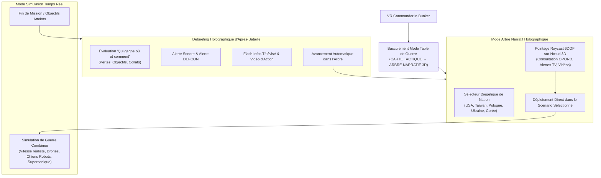

# SAFe Program Increment 05 — Sprint 5 Specification
## In-Bunker Diegetic Campaign Story Tree, 6DOF VR Nation Selection & Autonomous Metagame Loop

> **Iteration**: Program Increment 05 (PI-05), Sprint 5  
> **Commercial Target**: AA Commercial VR Retail Standard ($20–$30 USD on Meta Quest Store & SteamVR)  
> **Focus**: Diegetic VR Integration (Zero 2D UI Overlays), 6DOF War Table Mode Switching (`TACTICAL_MAP` vs `CAMPAIGN_STORY_TREE`), Raycast Interaction on Story Nodes, Post-Battle Debrief Projector, and End-to-End Autonomous Bot Campaign Runs.

---

## 1. Executive Summary & Design Thinking Context

---

## 2. Epics & User Stories du Sprint 5

### Epic 1 : Intégration Diégétique sur la Table de Guerre (FEAT-S5-01)
- **US-S5-01A (Modes d'Affichage Holographique de la Table)** :
  * *En tant que joueur en VR*, je veux basculer la Table de Guerre entre la carte topographique 3D du théâtre et l'arbre holographique de campagne sans aucun menu 2D flottant.
  * **Critères d'Acceptation** :
    1. `WarTable` supporte `set_display_mode(DISPLAY_MODE_TACTICAL)` et `set_display_mode(DISPLAY_MODE_STORY_TREE)`.
    2. En mode `STORY_TREE`, les nœuds 3D de la nation active sont générés avec des matériaux émissifs (vert pour complété, ambre pulsant pour actif, bleu/cyan pour verrouillé).
    3. Les lignes de transition laser relient les nœuds avec étiquettes d'issue (`DECISIVE_VICTORY`, `TACTICAL_HOLD`, etc.).

### Epic 2 : Interaction 6DOF Raycast & Sélecteur de Nation (FEAT-S5-02)
- **US-S5-02A (Sélection de Nation et Inspection de Nœud par Laser VR)** :
  * *En tant que commandant*, je veux pointer mon contrôleur VR sur un drapeau national ou un nœud narratif pour afficher instantanément sa fiche de doctrine, son OPORD et son flash vidéo.
  * **Critères d'Acceptation** :
    1. Interaction laser 6DOF détectant les nœuds de l'arbre et les drapeaux.
    2. Changement de nation instantané mettant à jour les unités disponibles, le budget et le scénario actif.

### Epic 3 : Débriefing d'Après-Bataille & Visière Vidéo d'Action (FEAT-S5-03)
- **US-S5-03A (Débriefing Diégétique Holographique)** :
  * *En tant que joueur*, après la fin d'une bataille, je veux voir un panneau d'évaluation holographique émerger au centre de la table avec le résultat, le décalage DEFCON et le flash TV.
  * **Critères d'Acceptation** :
    1. Affichage du ratio de pertes et de l'issue déterminée par `CampaignStoryTreeSystem`.
    2. Déclenchement de la sirène et du nouveau niveau DEFCON.
    3. Lecture du flash TV avec clip vidéo d'action.

### Epic 4 : Boucle Autonome de Simulation de Campagne Entière (FEAT-S5-04)
- **US-S5-04A (Playtest Autonome Acte I -> Acte II -> Acte III)** :
  * *En tant qu'ingénieur QA*, je veux que `SimPlaytesterBot` puisse enchaîner automatiquement une campagne complète, évaluer les branches empruntées et certifier la robustesse du système.
  * **Critères d'Acceptation** :
    1. Le bot traverse au moins 2 batailles successives jusqu'au dénouement (Climax).
    2. Latence mesurée < 100 ms et score de jouabilité > 90%.

---

## 3. Livrables Visuels & Critères de Fin de Sprint (DoD)

1. **Preuves Visuelles sur NVIDIA GeForce RTX 4060 Ti** :
   - `sprint5_01_vr_interactive_story_tree.*` : Table de guerre en mode Arbre Narratif 3D avec pointage laser VR.
   - `sprint5_02_vr_nation_switch_doctrine.*` : Basculement diégétique entre nations avec drapeaux et doctrine.
   - `sprint5_03_autonomous_campaign_playthrough.*` : Progression autonome d'une campagne complète par le bot.
   - `sprint5_04_diegetic_debrief_news_visor.*` : Panneau de débriefing holographique et visière TV.
2. **Suite de Tests Unitaires Sprint 5 (100% PASS)** :
   - `tests/test_sprint5_features.gd` validant le basculement de mode, le ciblage raycast, l'enchaînement de campagne et les performances.
