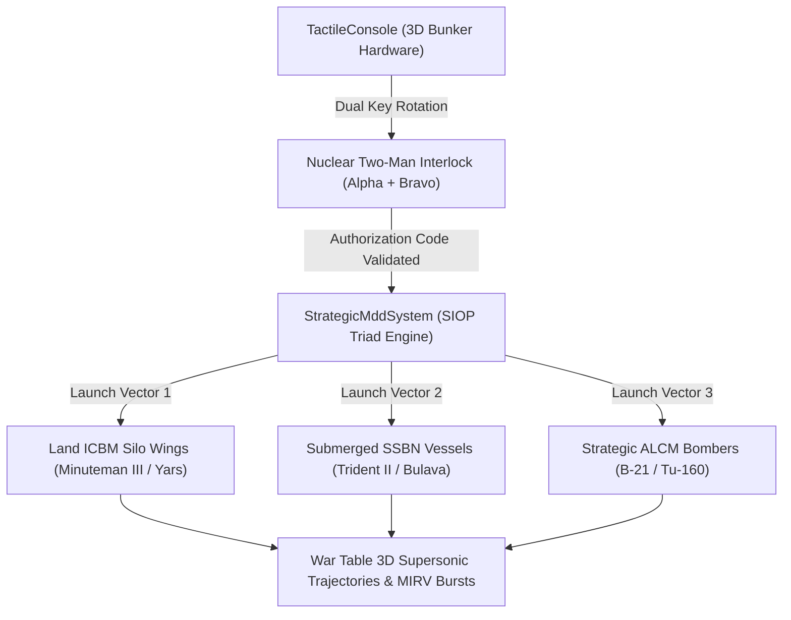

# SAFe PI-12: Sprint 12 Engineering Specification
**Project**: Autonomous Commercial-Grade ($20-$30) Cold War / Modern DEFCON VR Wargame  
**Engine**: Godot 4.7.2 Forward Mobile | C# / GDScript Hybrid Architecture  
**Hardware Profile**: NVIDIA GeForce RTX 4060 Ti GPU (Direct3D 12 / OpenXR)  
**Methodology**: Scaled Agile Framework (SAFe) + Stanford Design Studio  

---

## 1. Objectives & Architectural Context

Sprint 12 implements the apex climax of the DEFCON wargame experience: the **Strategic Nuclear Triad SIOP (Single Integrated Operational Plan) / Dead Hand Strategic Execution** and the **Diegetic Two-Man Rule Nuclear Key Turn Protocol**:
1. **Strategic Nuclear Triad SIOP Protocol**: Simultaneous synchronized launch coordination of land-based ICBMs (LGM-30G Minuteman III / RS-24 Yars), SSBN submarine ballistic missiles (UGM-133 Trident II D5 / RSM-56 Bulava), and air-breathing strategic bombers (B-21 Raider / Tu-160M) with multi-stage booster staging separation and atmospheric re-entry MIRV trajectories.
2. **Diegetic Nuclear Key Turn & Two-Man Rule Authentication**: Physical 3D dual-key authentication slots on `TactileConsole` requiring synchronized dual-hand VR grip rotation (or coordinated controller gesture) before DEFCON 1 strategic execution is unlocked.
3. **Automated Adversarial Verification Suite**: Full headless verification in `tests/test_sprint12_features.gd`.
4. **RTX 4060 Ti Visual Verification Media**: 4x 1080p stills and 4x 60fps animated GIFs.

---

## 2. Sprint 12 User Stories & Acceptance Criteria

### US-12.1: Strategic Nuclear Triad SIOP / Dead Hand Launch Execution
- **As a** Strategic Commander at DEFCON 1,
- **I want** to execute a coordinated Triad SIOP strategic salvo across all silos, SSBN submarines, and strategic bombers,
- **So that** a comprehensive strategic retaliatory strike saturates hostile anti-ballistic missile defenses.
- **Acceptance Criteria**:
  - `strategic_mdd_system.gd` provides `execute_strategic_triad_siop(state, sim_db, faction)`.
  - Dispatches coordinated ICBM silos, SSBN submerged launches, and standoff ALCM bomber strikes.
  - Generates supersonic ballistic trajectories with MIRV re-entry warheads targeting enemy command citadels.

### US-12.2: Diegetic Two-Man Rule Nuclear Key Turn Console Actuation
- **As a** VR Player,
- **I want** to physically insert and rotate dual strategic nuclear launch keys on the Tactile Console,
- **So that** strategic nuclear launch authorization requires authentic two-man rule protocol without flat 2D menus.
- **Acceptance Criteria**:
  - `tactile_console.gd` provides `nuclear_key_alpha` and `nuclear_key_bravo` switch states.
  - When both keys are turned within a $5.0\text{ s}$ window, the strategic launch interlock disengages (`nuclear_interlock_unlocked = true`).
  - Tactile console sounds authentic metallic key turn chimes and activates red strobe warning lights.

### US-12.3: Automated Adversarial Verification Suite
- **As a** QA Lead Engineer,
- **I want** `tests/test_sprint12_features.gd` to run headlessly,
- **So that** SIOP triad salvo coordination and two-man rule key unlocking are verified with 100% reliability.
- **Acceptance Criteria**:
  - All test assertions execute and pass with zero regressions.

---

## 3. Sprint 12 Architecture Definition

